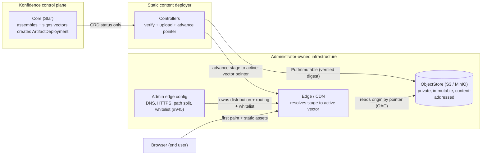
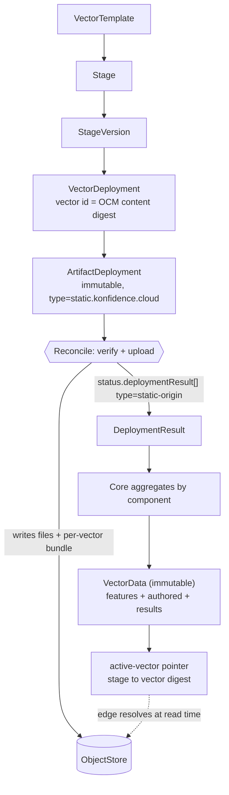
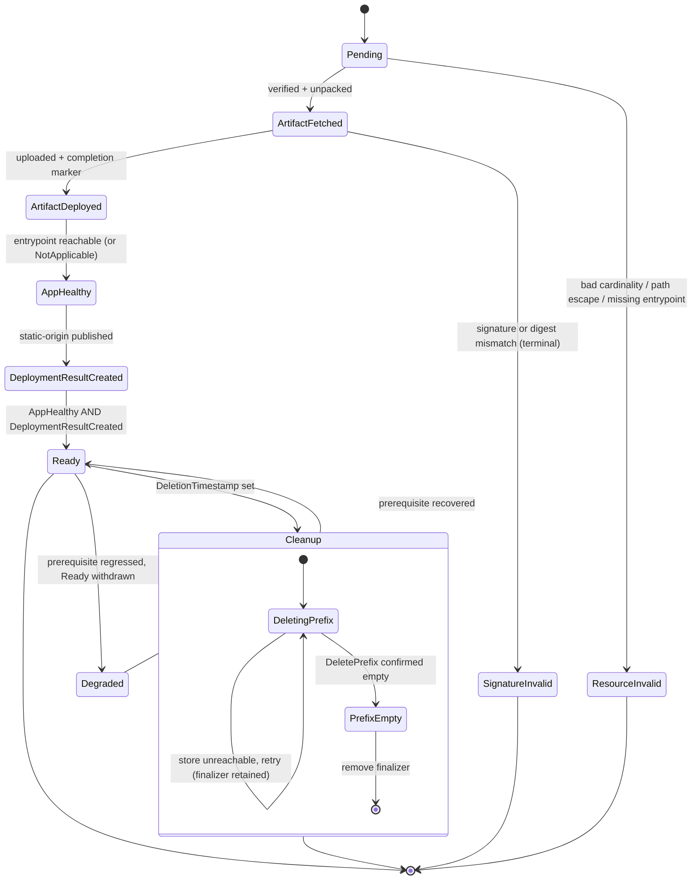
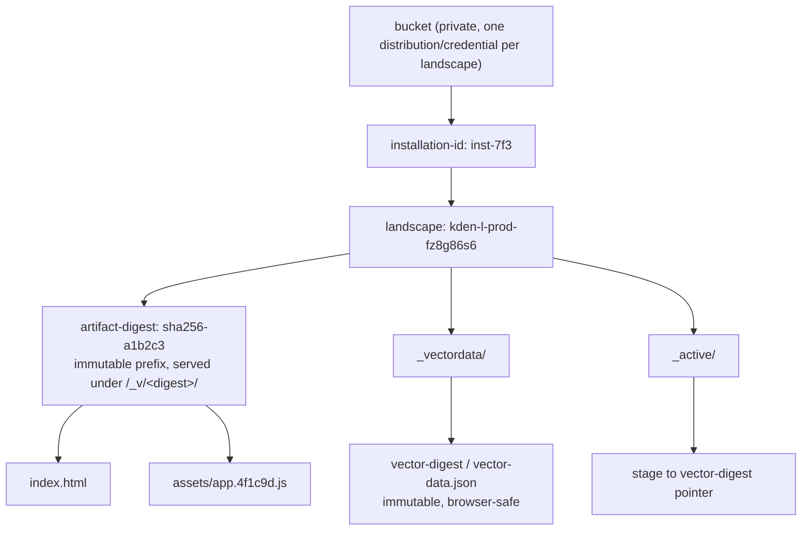
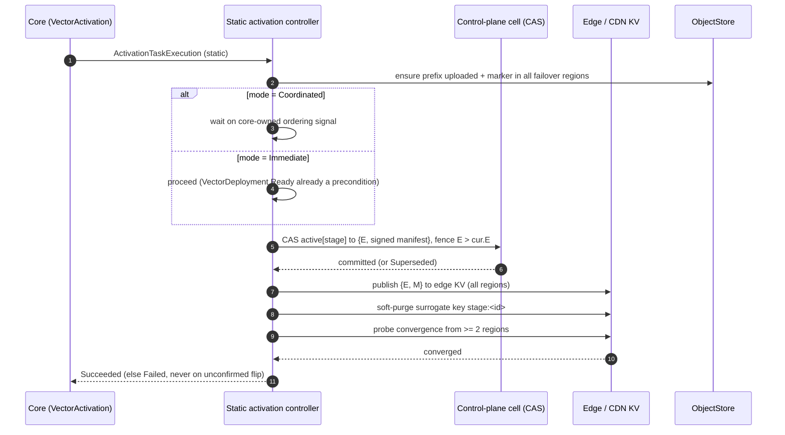
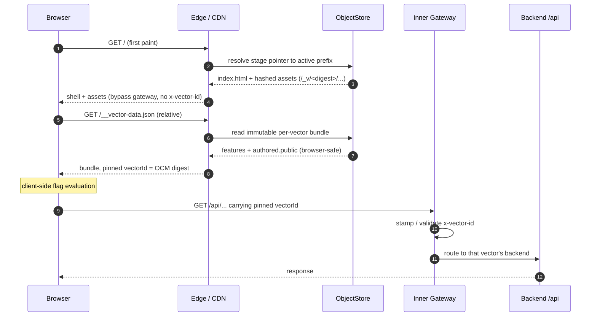
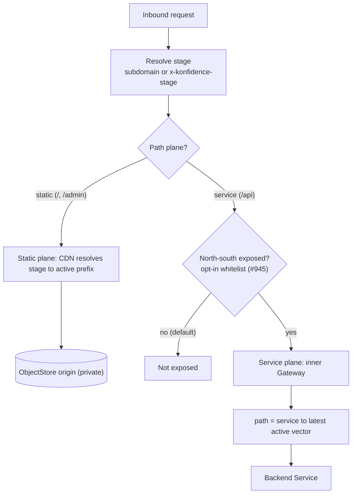
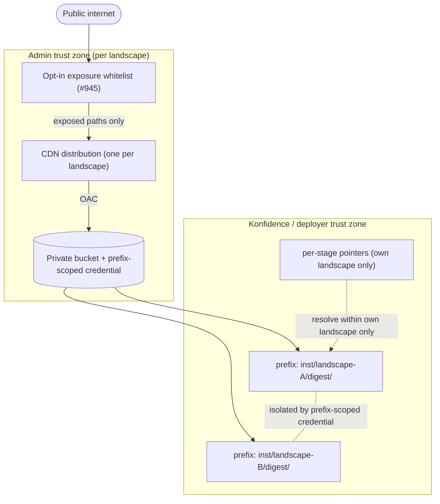
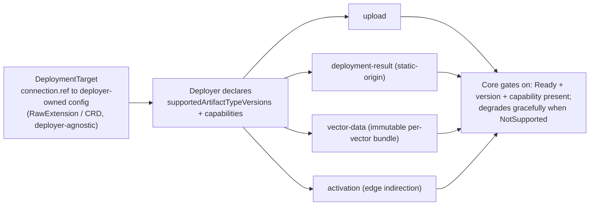

# ADR-0039: Static content deployer

<AdrHeader />

> Revision note. This document supersedes the first draft of ADR-0039. It was rebuilt after five
> staff-engineer review councils (distributed systems, API boundaries, CDN/edge, vector-data,
> security/ops) and a second round grounded in the post-#797 routing decisions, EPIC #351 (the
> deployer specification + Go bindings), and the OCM specification/bindings. The decisions below
> replace the earlier "re-point CDN config per activation" and "live OFREP in the browser" models.
> Deep implementation material lives in the appendices and the deployer specification, not in the
> decision body.

---

## Context

A stage serves several applications under one hostname: static front-ends delivered by a content
delivery network (CDN) and APIs delivered by Konfidence's public gateway. Konfidence needs a
deployer that publishes static web applications to S3-compatible object storage and makes a new
release live at a stable public URL, coordinated with the rest of the vector.

The defining constraint: **the stored files are immutable, but the bytes served at a stage's public
URL change on activation.** Routing and caching are therefore part of activation, not a side effect
of upload. Uploading a release must not change what a stage serves; activation must.

Two facts from the current platform shape every decision here:

- Static assets are served by the CDN directly, bypassing the gateway, so a loaded page carries no
  `x-vector-id`. Only `/api` requests traverse the gateway and get stamped (ADR-0037).
- Owner-reference garbage collection cannot reach object storage or a CDN, so cleanup must be
  finalizer-driven (deployer specification §3.5). The Kubernetes reference deployer (KLO) relies on
  Flux GC and does not implement this; this deployer cannot.

This deployer is also the first non-Kubernetes destination in Konfidence. It therefore doubles as
the conformance probe EPIC #351 and deployer-specification §9 call for — a "substantially different
target platform" that validates the mandatory subset of the specification and the generic Go library.

## Scope and related decisions

- The **administrator** owns the bucket, access credentials, DNS, HTTPS, the CDN/edge, the public
  path assignments, and the exposure whitelist. Konfidence owns only the files this deployer writes
  and the stage→active-vector pointer the edge resolves. Kubernetes routing remains with KLO.
- Constrained by the deployer specification (EPIC #351), ADR-0038 (artifact-type deployer
  selection), ADR-0037 and konfidence #797/#944–#947 (north-south routing), ADR-0034 (naming),
  ADR-0027 (landscape/target), and the OCM specification.
- **Out of scope for the first version:** pinning already-open browser tabs to the vector that
  served them (session stickiness). The design records the mechanism that unlocks it but does not
  build it.

---

## Considered options

### Option A — Edge indirection + a `static-origin` deployment result *(chosen)*

The deployer uploads immutable, content-addressed objects and publishes a deployment result naming
the active origin. Activation advances a single mutable `stage→active-vector` pointer that the
administrator's edge resolves at request time; the deployer never reprograms CDN configuration.

- **Pros:** fits the standard deployer contract; activation is a fast pointer write, not a
  minutes-scale CDN control-plane deploy (the latency class ADR-0037 exists to remove); instant,
  forward-only rollback by advancing the pointer to a retained prefix; near-zero cache invalidation;
  Konfidence never holds CDN-config-write credentials; works uniformly with the k8s routing model
  ("resolve stage → latest active vector").
- **Cons:** requires an edge that can resolve a key at request time (edge KV / function) or an
  administrator-run resolver for the fallback; introduces a new result type and a capability the
  ecosystem must learn.

### Option B — "No deployment results"

The draft floated uploading files and leaving all routing to the administrator (ADR-0039 draft, the
"don't actually have deployment results?" note).

- **Rejected:** nothing tells activation which prefix is active, there is no coordinated switch, and
  it breaks multi-runtime vectors where a frontend and backend activate together.

### Option C — Re-point CDN configuration per activation

The first draft of this ADR. On each activation the deployer mutates the administrator's
distribution (origin path / behavior).

- **Rejected:** reintroduces the minutes-scale managed-edge reprogramming ADR-0037 was written to
  eliminate; forces the deployer to hold distribution-wide write credentials (large blast radius);
  makes activation latency a function of the provider's config-propagation time; inverts the
  ADR-0037 ownership model (admin owns the data plane).

### Option D — Host the front-end as a Kubernetes pod behind the gateway

The status quo: no new deployer; serve the SPA from an nginx `Deployment` + `Service`.

- **Rejected:** always-on compute that cannot scale to zero, added gateway route churn, and an
  operational surface (image builds, probes, rollouts) for content that is just files. This is where
  the cost argument lives — as a rejection rationale (see Consequences).

### Option E — Live OFREP in the browser vs. an immutable per-vector bundle

How a browser obtains its features, authored config, and backend address.

- **Rejected (live per-flag OFREP through the gateway):** OFREP is POST-only and uncacheable, puts
  the in-cluster vector-data service on every first-paint critical path (re-adding the compute
  Option D removed), causes flag-flicker, and — because the page's bytes came from the vector active
  *at load* while the gateway stamps the vector active *at call* — silently evaluates flags against
  a different vector than the code expects.
- **Chosen:** deliver an **immutable, content-addressed, browser-safe per-vector bundle** from the
  edge; evaluate flags client-side; keep OFREP for server-side consumers where it is correct. This
  pins code and config to the same vector by construction and is infinitely cacheable because
  `VectorData` is immutable per vector.

---

## Decision

1. Konfidence ships a second **reference deployer** that owns the artifact type
   `static.konfidence.cloud` and reconciles the standard control-plane resources (`DeploymentTarget`,
   `ArtifactDeployment`, and — as separately declared capabilities — vector-data materialization and
   activation).
2. The deployer **MUST** verify the OCM component's signature and recompute the payload resource
   digest against the signed descriptor **before** uploading any byte, and **MUST** treat a
   verification failure as terminal (not retryable).
3. Uploads **MUST** be immutable and content-addressed by the **verified OCM resource digest**, laid
   out so that landscapes and installations sharing a bucket cannot collide.
4. The deployer **MUST** publish a `static-origin` deployment result that names the active origin for
   its own activation use. Origin coordinates (bucket, endpoint, region, key prefix) **MUST NOT**
   appear in any `VectorData` projection delivered to a browser.
5. Activation **MUST** be an edge indirection: advance one monotonically fenced `stage→active-vector`
   pointer; it **MUST NOT** mutate stored files and **MUST** report `Succeeded` only after the edge
   has converged. A routing or cache failure **MUST** be reported as failure, never success.
6. North-south exposure **MUST** be opt-in: an uploaded-but-not-whitelisted application **MUST NOT**
   be internet-reachable (konfidence #945). The origin bucket **MUST** be private; the edge is the
   only public reader.
7. The deployer **MUST** implement finalizer-driven cleanup and **MUST NOT** report deletion complete
   while owned objects remain; it **MUST** provide an operator escape hatch that records orphaned
   objects when the destination is permanently unreachable.
8. The deployer **MUST** carry its S3/CDN configuration deployer-agnostically (a deployer-owned CRD
   or `RawExtension` behind `DeploymentTarget.connection.ref`); core gains **zero** S3/CDN-specific
   fields (konfidence #946).
9. The deployer **SHOULD** consume the generic deployer Go library (EPIC #351) rather than
   re-implement finalizers, the condition ladder, result publishing, and target validation, and
   **MUST** declare which optional capabilities it supports and report unsupported behavior so core
   and the UI degrade gracefully.
10. Cross-runtime ordering ("serve the UI only after the rest of the vector is live") **MUST** be
    expressed as declarative data on a runtime-neutral activation graph, not as deployer code that
    waits on another runtime. This deployer **MUST NOT** read any other deployer's executor
    condition or any runtime-specific signal (routes, services, `Programmed`, "the backend"); it
    gates only on the core-owned signal that its declared predecessors have reached `Succeeded`.

### Design decisions

1. **Vector identity is an opaque, content-addressed token sourced from core** — assumed to be the
   OCM vector digest (konfidence #797 open question). The deployer **MUST NOT** derive identity from
   a Kubernetes object name. Two addressing axes are kept distinct: the **artifact-content digest**
   addresses bytes/origin; the **vector digest** addresses routing and the per-vector config bundle.
2. **Key layout:** `<installation-id>/<landscape>/<artifact-digest>/<app-key>` for content, plus
   `<installation-id>/<landscape>/_vectordata/<vector-digest>/vector-data.json` (immutable per-vector
   bundle) and a per-stage pointer cell. Writes are once-only; a matching digest makes reconcile a
   no-op.
3. **Version-stable asset base.** Applications are built and served with an immutable public asset
   base `/_v/<artifact-digest>/…`. The edge resolves the pointer only for `/` (entrypoint) and the
   per-vector bundle; `/_v/<digest>/…` is a pointer-independent passthrough. With keep-N retention
   this guarantees an in-flight session never 404s on a lazily loaded chunk after a flip.
4. **Activation commit protocol.** The commit is a single compare-and-swap on a strongly consistent
   control-plane cell, fenced on the monotonic stage version; it is then published to the
   eventually-consistent edge, and `Succeeded` is reported only after multi-region convergence is
   observed. Rollback is forward-only: a new fenced epoch pointing at a retained prefix.
5. **Switch modes.** `Immediate` gates only on the deploy-time floor (`VectorDeployment Ready`, the
   runtime-neutral aggregate of *every* artifact deployment across *every* deployer being deployed
   and healthy). `Coordinated` additionally orders the static flip *after* the rest of the vector
   has **activated**, by declaring the other activation executions as predecessors on a runtime-
   neutral acyclic graph and gating only on "all declared predecessors reported `Succeeded`." No
   runtime-specific term (`Programmed`, route, service, "backend") appears in the gate; the static
   deployer knows nothing about peer runtimes.
6. **Browser config delivery.** The deployer materializes an immutable, browser-safe per-vector
   bundle; a one-hop bootstrap resolves the active vector digit and the bundle URL; the browser pins
   that identity and sends it in-band on `/api` calls. Server-side consumers keep OFREP unchanged.
7. **OCM modeling.** The payload is an OCM resource of type `directoryTree`
   (`application/x-tar`), built reproducibly, resolved by digest after transport/localization
   (`localBlob`), never by a mutable tag. `static.konfidence.cloud` is only the deployer-selection
   artifact type. Per-app config lives in OCM labels: `entrypoint` as a **signed** label;
   `cacheRules` and the exposure flag as non-signed labels.
8. **Integrity to the browser.** Per-file OCM digests are published as Subresource Integrity (SRI) in
   the entrypoint, anchoring the chain component-signature → verified tar digest → per-asset SRI.
9. **Provider neutrality** via two interfaces — an object store and an edge resolver — so a new
   provider is an interface implementation, not a controller change. First supported setups:
   S3 + an edge-KV resolver (e.g. CloudFront Functions + KeyValueStore), and MinIO + an
   administrator-run resolver for cloud-free CI.

---

## Artifact and OCM packaging

`static.konfidence.cloud/v1alpha1` (the draft's `static.konfidence.cloud-v1alpha1` violates the
deployer-spec grammar `<type-name>/<version>`).

The OCM component carries the mandatory `konfidence-manifest` resource and **one** payload resource:

```yaml
# component-constructor.yaml
components:
  - name: github.com/acme/frontend
    version: 1.0.5
    provider: { name: acme }
    resources:
      - name: konfidence-manifest
        type: cloud.konfidence.artifact.manifest
        relation: local
        input: { type: file/v1, path: ./konfidence-manifest.json }   # { "type": "static.konfidence.cloud/v1alpha1", "allowReuse": true }
      - name: static-content
        type: directoryTree                 # OCM core type for "filesystem content as tar"
        relation: local
        input:
          type: dir
          path: ./dist
          mediaType: application/x-tar
          reproducible: true                # byte-stable tar => stable digest => true content addressing
        labels:
          - { name: static.konfidence.cloud/entrypoint, value: index.html, signing: true }
          - { name: static.konfidence.cloud/cache-rules, value: {...} }       # non-signed, admin-tunable
          - { name: static.konfidence.cloud/expose, value: "false" }          # non-signed exposure flag
```

Packaging rules (normative text lives in the deployer specification; summarized here):

- Exactly one `directoryTree` payload resource; it **MUST** unpack to a directory tree.
- The entrypoint (default `index.html`, from the signed label) **MUST** exist; the bundle **MUST NOT**
  contain path-escaping entries. Invalid packages → `Ready=False, reason=ResourceInvalid`, nothing
  uploaded.
- The deployer resolves content by digest from the signed, transported component — not by tag — and
  verifies the resource digest and signature before upload (see Appendix B).
- Files are uploaded unchanged; only object metadata (content type, cache control, SRI) is added.

The vector is modeled as an **aggregating OCM component** that references the frontend, the backend,
and the vector-config resource, so recursive signing and transport-stable addressing apply to the
whole vector.

---

## Storage layout

```text
bucket (admin-provided, private, one distribution/credential per landscape)
└── <installation-id>/                               # stable control-plane id; global-collision guard
    └── <landscape>/                                 # from the konfidence.cloud/landscape label
        ├── <artifact-digest>/                       # sha256 of the verified directoryTree resource
        │   ├── index.html
        │   └── assets/app.4f1c9d.js                 # content-hashed, served under /_v/<artifact-digest>/
        ├── _vectordata/<vector-digest>/vector-data.json   # immutable, browser-safe per-vector bundle
        └── _active/<stage>                          # pointer cell: stage -> active vector-digest
```

- The prefix embeds installation, landscape, and the **verified content digest**, so distinct
  installations, landscapes, and releases cannot overwrite one another, and identical bytes dedupe.
- Public URLs are always the stage hostname; storage keys never appear in a public URL and never in a
  browser-visible bundle.
- Objects are write-once; a per-prefix completion marker written last is the atomic "upload complete"
  signal. Previous prefixes are retained for keep-N releases to guarantee rollback and in-flight
  asset availability.

---

## Upload reconciliation

1. Act only on `ArtifactDeployment` whose `spec.manifest.type == static.konfidence.cloud` and whose
   version is supported; an unsupported version **MUST NOT** be treated as another version.
2. Require a `Ready` `DeploymentTarget` for the type; otherwise stall (do not deploy).
3. Add the finalizer before any remote write.
4. Resolve the transported/localized component, **verify signature + payload digest**, unpack.
5. Upload immutably with content type, cache control, and SRI; write the completion marker last.
6. Publish the `static-origin` result; run the condition ladder with negative transitions
   (`ArtifactFetched → ArtifactDeployed → AppHealthy → DeploymentResultCreated → Ready`, each
   withdrawn if a prerequisite regresses).
7. On deletion: delete the prefix, confirm empty, then remove the finalizer; retain and retry if the
   store is unreachable; an operator annotation (`konfidence.cloud/force-cleanup=orphan`) releases the
   finalizer while recording the orphaned objects as an event/condition.

Generic behavior (finalizer lifecycle, condition state machine, result uniqueness, target gating,
status-patch discipline) is consumed from the EPIC #351 Go library; the deployer implements only the
object-store/edge interfaces and type-specific validation.

---

## Deployment results and vector data

### `static-origin` (deployer-internal)

Carries the origin the deployer needs to resolve a pointer: `{ provider, keyPrefix, assetBase,
entrypoint, contentDigest }`. Its stable `name` is the public path identity (the ADR-0037 "stable
name = path segment" rule). It is consumed only by this deployer's activation. Origin coordinates are
**not** placed in any browser-reachable projection.

### Browser-safe per-vector bundle

Materialized as an immutable object `_vectordata/<vector-digest>/vector-data.json`, server-side
filtered to:

```json
{
  "vectorId": "<vector-digest>",
  "features": { "enableBetaCheckout": true, "maxUploadMb": 25 },
  "authored": { "public": { "apiBasePath": "/api", "theme": "dark" } },
  "results": [ { "name": "ui", "type": "static-ref", "publicPath": "/" } ]
}
```

`features` and an allow-listed `authored.public` subtree are included. Result projection is an
**allow-list by producer-declared classification**, not a deny-list of known Kubernetes types: each
deployer marks each result type as browser-safe or internal, and core projects only browser-safe
results into the bundle. A deny-list keyed on `http-k8s-service` would silently leak any *future*
runtime's internal result (a FaaS ARN, a database DSN); the allow-list is runtime-neutral and
closed by default. The `results` array therefore generalizes to a map of heterogeneous runtime
endpoints — a UI resolves whichever its code understands, not "the k8s API at `/api`." The full,
unfiltered bundle remains available in-cluster over OFREP for trusted server-side consumers.

Because `VectorData` is immutable per vector, this object is immutable and content-addressed: cache
it for a year, and a browser that reads it is pinned to exactly the vector that served its bytes.

---

## Routing and activation

The split (per ADR-0037 / #944–#947): the administrator's edge owns DNS, TLS, the distribution, the
path map, and sets `x-konfidence-stage`; the inner gateway handles `/api` (path → service → latest
vector, injecting `x-vector-id`); the static plane is the CDN resolving `stage → active vector →
origin prefix`. Static requests never touch the gateway.

Activation is the static-plane twin of #947's per-stage, patched-in-place route: **one pointer per
`(landscape, stage, path)`, advanced to the latest active vector's origin — never a per-vector or
per-artifact rule.** The commit/convergence protocol is in Appendix A. Exposure is opt-in: the
activation controller advances a pointer only for a whitelisted result (konfidence #945); everything
else is uploaded but unreachable.

### The activation switch

The requirement — "serve the UI only once the rest of the vector is live" — is a cross-runtime
ordering problem, and it must hold for *any* mix of runtimes (Kubernetes, WebAssembly, FaaS, a second
static site, a managed cloud service, a database-config deployer), not just a Kubernetes backend. The
design therefore distinguishes two runtime-neutral readiness levels and never names a peer runtime.

- **`Immediate`.** The pointer is advanced as soon as the activation runs. Its only guarantee is the
  **deployed-ready floor**: core requires `VectorDeployment Ready` before any activation executes, and
  that condition aggregates the `Ready` of *every* `ArtifactDeployment` regardless of deployer. It
  does **not** guarantee that other runtimes have flipped their own serving pointers — only that their
  content is deployed and healthy.
- **`Coordinated`.** The static flip happens only after the rest of the vector has **activated**. This
  deployer declares the other activation executions as predecessors on the runtime-neutral activation
  graph (`ActivationTaskRegistration.Succeeds`/`Precedes`) and gates solely on the core-owned signal
  "all declared predecessors reported `Succeeded`." It reads no route condition, no service, no
  `Programmed`, and nothing a specific runtime emits. "Serve the UI last" is one row of ordering
  **data**, not code that waits on "the backend."

Which level satisfies the requirement: only `Coordinated`. "Live" is a routing property that flips at
activation, so the deployed-ready floor (`Immediate`) is strictly weaker — it permits a new UI against
backends that are healthy but not yet routed. The ADR states this honestly rather than defaulting to a
mode that does not meet the stated goal.

Honest limits. Cross-runtime activation is **not** an atomic or simultaneous commit — no shared
abortable prepare phase exists across heterogeneous runtimes, so two-phase commit is not even
runtime-neutral. With the UI gated last, a partial failure leaves the **safe** skew (old UI against a
partially-new vector), never a new UI against not-yet-live peers; recovery is forward-only via a new
fenced epoch (Appendix A). Already-open tabs are not pinned (deferred stickiness). The achievable
guarantee is a best-effort *happens-after* ordering with per-runtime atomicity and bounded, self-
healing skew — stated precisely in the generic contract below.

### Generic cross-runtime readiness and activation contract

Stated with zero runtime-specific terms, so it holds for any present or future runtime:

- **Readiness.** A vector is *deployed-ready* when every artifact deployment it contains reports
  `Ready`, independent of each artifact's runtime or deployer. Deployed-readiness is the precondition
  for any activation.
- **Ordering.** Activation is a set of executions, one per participating runtime, scheduled as a
  declarative directed acyclic graph: each execution declares which others it must follow. An
  execution may begin only after every execution it depends on has reported `Succeeded`. No execution
  knows the identity, shape, or location of any other; it observes only the core-owned "predecessors
  succeeded" signal. The graph is validated acyclic before scheduling and is bounded by a deadline.
- **Commit.** Each execution commits its own cutover atomically, fenced on the monotonic stage
  version, idempotent, and forward-only; it reports `Succeeded` only after its own convergence is
  confirmed. The vector's single active pointer advances only once all executions have succeeded.
- **Guarantee.** Activation provides a best-effort *happens-after* ordering across runtimes with
  per-runtime atomicity, monotonic fencing, and forward-only recovery. It does **not** provide
  cross-runtime atomic or simultaneous cutover; between the first and last runtime's convergence, and
  on partial failure, a bounded, self-healing skew is expected and permitted.

Under this contract "serve the UI last" is the UI's execution declaring the other executions as
predecessors — one row of data, no runtime names. It works identically whether the predecessors are
Kubernetes, WebAssembly, FaaS, another static site, a managed cloud service, or a database-config
deployer. Coordination cost is O(N) in the number of runtimes, not O(N²): each execution watches one
core-owned signal, not every peer. The core primitives this contract requires are tracked as Open
Questions 3, 8, and 9; this deployer's Appendix A protocol is already the per-runtime fenced,
forward-only commit the contract mandates.

---

## Caching

- Content-hashed assets under `/_v/<artifact-digest>/…` → `public, max-age=31536000, immutable`;
  cache key is path-only; query strings are stripped so cache-busting collapses to O(1).
- The entrypoint and the per-vector bundle are the only mutable surfaces; they are tagged with a
  surrogate key `stage:<id>` and soft-purged on activation (one tag, not a path list).
- A new release lands at a new digest prefix with new asset URLs, so asset paths are never
  invalidated; only the entrypoint/bundle flip. Per-stage pointers mean two stages on different
  versions read different immutable prefixes and never share cache.

---

## Capability declaration

The deployer advertises its optional capabilities so core and the UI degrade gracefully (the ADR
EPIC #351 requires for optional-capability declaration):

```yaml
status:
  controller: konfidence.cloud/static-content-deployer:v0.1.0
  supportedArtifactTypeVersions: [v1alpha1]
  capabilities:
    upload: Supported
    deployment-result: Supported
    vector-data-materialization: Supported
    activation: Supported
```

When a capability is `NotSupported`, core **MUST** advance readiness through the alternative path and
represent the partial capability in aggregated `VectorData` status rather than stalling.

---

## Security and multi-tenancy

- **Private origin.** Bucket public access off; the edge is the only reader (OAC / signed origin /
  mTLS for the self-run resolver). Uploaded-but-not-whitelisted content is unreachable.
- **Enforced isolation, not convention.** One distribution and one **prefix-scoped** credential per
  landscape (the analog of #944's "one inner Gateway per landscape"); the deployer refuses `Ready`
  if it can prove its credential is broader than its prefix. A shared distribution across trust
  domains is forbidden because there is no CDN analog to `allowedRoutes`/`ReferenceGrant`.
- **Supply chain.** Verify-before-serve (Decision 2); publish SRI so a tampered edge object is
  detectable by the browser.
- **Cost governance.** User egress is traffic-bound and unchanged by the hosting model; the
  immutable layout keeps invalidation near-free. Adversarial egress (cache-busting, hotlinking,
  volumetric) is the administrator's edge responsibility (WAF, rate limits, budget alarms), stated
  as an explicit ownership boundary.

---

## Consequences

**Positive**

- Front-end hosting scales to zero; removes the always-on pod and gateway route churn for static apps.
- Immutable, content-hashed assets make the edge cacheable indefinitely and reduce invalidation to a
  single soft-purged surrogate key per release.
- Forward-only rollback is a pointer advance to a retained prefix — no re-upload.
- Verify-before-serve plus SRI give end-to-end integrity for internet-served content.
- Proves the deployer specification against a non-Kubernetes runtime and is the Go library's first
  non-k8s consumer; it passes the finalizer and negative-transition clauses the Kubernetes reference
  deployer currently fails.

**Negative**

- Introduces a new deployment-result type and an activation capability the ecosystem must learn.
- The cross-runtime switch is best-effort ordering, not an atomic or simultaneous cutover; a bounded,
  self-healing skew is expected between the first and last runtime's convergence and on partial
  failure. `Coordinated` is fully generic across runtimes but depends on core enforcing the activation
  graph (Open Questions 3, 8, 9), which is declared but unbuilt today.
- Open tabs are not pinned across a switch.
- Requires an edge that resolves a key at request time, or an administrator-run resolver for the
  cloud-free fallback.

**Neutral**

- User-traffic egress is unchanged by the hosting model.
- The administrator retains ownership of bucket, DNS, HTTPS, CDN, and the public path map.

---

## Open questions

| # | Question | Owner | Decision needed |
|---|---|---|---|
| 1 | Vector identity: is it the OCM vector digest, exposed as an opaque token? | core / #797 | Confirm the token and its stability so routing, cache keys, and the per-vector bundle can key on it. |
| 2 | Source of `installation-id` (stable control-plane id) for the global-bucket collision guarantee. | core | Field/source + stability guarantee. |
| 3 | Does core honor `ActivationTaskRegistration.Succeeds`/`Precedes` as an enforced acyclic graph (topological scheduling, predecessor-`Succeeded` gating)? Today the fields are declared but consumed nowhere, so `Coordinated` is unbuilt. | core / #947 | Implement the scheduler; it is the one primitive that makes cross-runtime "UI last" generic. |
| 8 | Core liveness primitives for the N-runtime barrier: admission-time cycle rejection, event wakeup on predecessor completion, and a per-activation deadline turning a stuck execution into `Failed`. | core | Without these an absent executor for any one runtime stalls the whole vector's activation indefinitely. |
| 9 | Make the forward-only, epoch-fenced, idempotent commit (Appendix A) a normative conformance clause for *every* runtime, and renew/replace the 30s per-stage lease so a long N-runtime barrier is not preempted mid-flight. | spec / core | Safety under preemption currently depends on every runtime implementing a correct fence. |
| 4 | ADR for optional-capability declaration and unsupported-behavior reporting (EPIC #351). | spec | Shape of `status.capabilities`; how an unsupported capability affects vector readiness. |
| 5 | Does the generic deployer Go library expose finalizer/condition/result/target primitives this deployer can consume? | core / #351 | Co-design using this deployer as the second, non-k8s consumer. |
| 6 | Browser bootstrap: edge resolver availability across target providers (CloudFront Functions/KVS, Workers KV, Fastly, Akamai, self-run). | this ADR | Confirm the portable request-time resolve primitive and the cloud-free fallback. |
| 7 | OCM transport: does the deployer receive an already-transported/localized component, or perform the transport-to-`s3` step itself? | core / spec | Determines where verification and localization run. |

---

## Traceability

| Decision | Satisfies | Source |
|---|---|---|
| Owns `static.konfidence.cloud`; standard CRDs | Deployer contract | deployer-spec §1–§3; ADR-0038 |
| Verify-before-serve; digest resolution; SRI | Integrity of internet-served content | OCM spec §02-processing; deployer-spec §3.2 |
| Content-addressed `installation/landscape/digest` layout | Shared-bucket, no-collision, cacheability | ADR-0039 draft §50–76; #797 |
| `static-origin` + browser-safe bundle split | Report origin without leaking it to clients | deployer-spec §4, §7; #945 |
| Edge-indirection activation + fenced pointer | Fast, safe cutover; no CDN reprogramming | ADR-0037; #947 |
| Declarative, runtime-neutral activation graph ("UI last" as data) | Generic cross-runtime ordering for any runtime mix | deployer-spec §8; #947; EPIC #351 |
| Opt-in exposure whitelist | North-south exposure is opt-in | #945; ADR-0037 D6 |
| Finalizer cleanup + escape hatch | Undeploy where GC cannot reach | deployer-spec §3.5 |
| Deployer-agnostic config behind `connection.ref` | Core stays deployer-agnostic | #946; ADR-0038 |
| Capability declaration | Optional-capability contract | EPIC #351; deployer-spec §2.3 |
| Immutable per-vector bundle, client-side flags | Browser config without stickiness/compute | ADR-0037 x-vector-id; #797 |

---

## Related ADRs and references

- **Depends on:** ADR-0027 (DeploymentTarget), ADR-0034 (naming), ADR-0037 (north-south routing and
  the `x-vector-id` contract), ADR-0038 (artifact-type deployer selection).
- **Normative detail:** the deployer specification §§1–8.
- **Tracking:** konfidence #797 (routing) and sub-issues #944–#947; konfidence #351 (deployer
  specification + Go bindings).
- **External:** OCM specification (`ocm-spec`) and Go bindings (`open-component-model/bindings`).

---

# Appendix A — Canonical activation and caching protocol

Terms: `E` = epoch = core stage version (monotonic). `id` = vector digest. `P(id)` = immutable
prefix. `A(id) = /_v/<artifact-digest>/` = version-stable asset base. `M(E)` = signed manifest
`{ epoch, prefix, assetBase, digest, vectorDataRef, prevEpoch }`.

**Build-time contract (validated by the deployer).** The SPA is built with public asset base
`A(id)`; the entrypoint references assets only through `A(id)`; a bundle that references assets by
root-relative `/assets/…` is rejected.

**Edge data plane (two behaviors, one mutable cell).**
- `GET /_v/<digest>/*` → pointer-independent passthrough to `P`; cache key `{host,path}`, query
  strings none, `max-age=31536000, immutable`; private origin.
- `GET /` and `GET /__vector-data.json` → edge reads `active[stage]={E,M}`, verifies `M`, resolves
  entrypoint/bundle; cache key `{host,path,E}`, surrogate key `stage:<id>`, soft-purgeable.

**Control-plane commit (strongly consistent, fenced).**
```
activate(stage, E, id):
  ensure P(id) uploaded + marker present in all failover regions      # multi-region correctness
  if mode == Coordinated: wait on core-owned ordering signal, else InProgress
  M = sign({E, P(id), A(id), digest, vectorDataRef, prevEpoch=cur.E})
  cur = CP_STORE.get(active[stage])                                    # DynamoDB/etcd/S3 If-Match
  if cur != null and E <= cur.E: return Superseded                    # fence defeats preemption
  if not CP_STORE.cas(active[stage], cur, {E, M}): retry/re-eval
  for region in edge_regions: EDGE_KV.put(active[stage], {E, M})      # publish (idempotent)
  EDGE.soft_purge("stage:" + stage)                                   # RFC 5861 soft purge
  if Converged(active[stage]==E, probes>=2 regions, deadline=KV_SLO): return Succeeded
  else return Failed(EdgeNotConverged)                                # never success on unconfirmed flip
```

**Guarantees:** no 404 for in-flight sessions (version-stable base + keep-N); no torn/mixed version
(signed manifest binds entrypoint+assetBase+bundle of one epoch); preemption defeated (single-object
CAS fenced on `E`); bounded, non-corrupting inconsistency window = edge-KV propagation SLO;
invalidation = one surrogate-key soft purge; forward-only rollback = new fenced epoch at a retained
prefix.

**Does not provide:** cross-POP read-your-writes for a roaming user (needs session pinning — the
deferred stickiness, implementable as a signed cookie carrying `E`); cross-runtime atomic commit.

**Edge resolver portability.** CloudFront Functions + KeyValueStore (seconds, in-process, no I/O —
ideal), Cloudflare Workers + KV / Durable Objects (≤60 s; DO for linearizable commit), Fastly
Config/KV Store + instant purge, Akamai EdgeWorkers + EdgeKV, and OpenResty + a watched shared-dict
for the self-run fallback. The portable primitive is "read a mutable cell in a request-time edge
function"; the strongly consistent CAS always runs in the control plane and is published to the
eventually consistent edge.

# Appendix B — OCM verification and integrity

Before upload the deployer **MUST**: (1) load the component descriptor and signatures from the
transported repository; (2) verify the signature over the normalized descriptor digest; (3) recompute
the `directoryTree` resource digest (`genericBlobDigest/v1`) from freshly accessed content and
compare to the signed `resource.digest`; (4) only then unpack and upload. Any failure is terminal
(`Ready=False, reason=SignatureInvalid` / `ResourceInvalid`).

Consume `bindings/go/signing` (`Verifier.Verify`, `VerifyDigestMatchesDescriptor`,
`IsSafelyDigestible`), `repository.GetLocalResource`/`DownloadResource` (which verify integrity),
and `bindings/go/transfer`+`ctf` for localization. Use the verified `sha256` resource digest as the
content-addressing key — not an incidental hash. During the verified unpack, compute per-file
`sha256`, emit a signed `integrity.json`, and inject SRI into the entrypoint, anchoring
component-signature → tar digest → per-asset SRI.

# Appendix C — Conformance matrix (this deployer as the second target)

| Deployer-spec clause | Status | Note |
|---|---|---|
| §1.1 exact type+version; unknown version ≠ other version | Pass | Fixes the KLO version-suffix gap |
| §1.2 one `konfidence-manifest`; validate before deploy | Pass | |
| §2.1 reconcile only own type; one target per type/ns | Pass | |
| §2.3 set `Ready`; report `supportedArtifactTypeVersions`; core checks before deploy | Partial | Needs ADR-0038 fields; shim until then |
| §3.2 validate independent of core/authoring tool | Pass | Plus OCM verify-before-serve |
| §3.4 no stale `Ready=True`; negative transitions | **Pass (KLO fails)** | Tracked KLO deviation |
| §3.5 finalizer before side effects; retain on failed cleanup | **Pass (KLO fails)** | Owner-ref GC cannot reach storage |
| §4 result `(name,type)` unique; opaque spec | Pass | `static-origin` + browser-safe `static-ref` |
| §5 reuse isolation | Pass | Bytes shared; no per-vector state in bytes |
| §6 VectorData materialization | Supported | Immutable per-vector bundle |
| §8 activation | Supported (optional) | Edge indirection, separate capability |

A MinIO + self-run-resolver harness runs the matrix cloud-free in CI and doubles as the "create a
basic custom deployer" tutorial (EPIC #351 success criterion 5).

# Appendix D — Diagrams

## D1. System context and ownership boundary



## D2. Control-plane resource flow



## D3. Upload reconcile lifecycle



## D4. Storage layout



## D5. Activation as edge indirection



## D6. Browser first paint



## D7. North-south vs east-west + whitelist gate



## D8. Trust and multi-tenant isolation



## D9. Capability declaration


