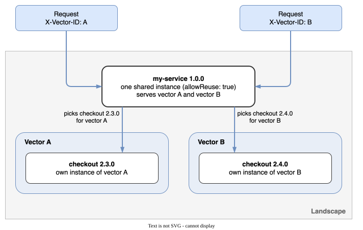
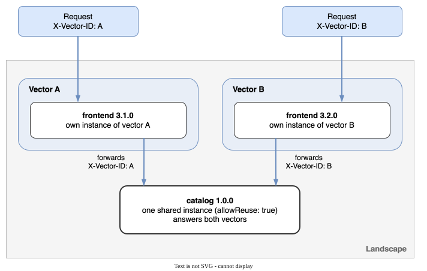

# Types of artifacts

Choose how to package your service for Konfidence and whether several vectors can share one deployed instance.
For the relationship between artifacts and application versions, see [Vectors and artifacts](../../core-concepts/vectors-and-artifacts.md).

## Choose an artifact type

The [Kubernetes deployer](../../deploy-operate/install/deployer/kubernetes.md) creates Flux resources that deploy Helm charts and Kustomize bundles to Kubernetes.

Choose the type that matches the deployment configuration you already maintain:

| Deployment configuration | Artifact manifest `type` | Authoring guide |
| --- | --- | --- |
| Helm chart | `helm.konfidence.cloud` | [Author a Helm artifact](./helm.md) |
| Kustomize bundle | `kustomize.konfidence.cloud` | [Author a Kustomize artifact](./kustomize.md) |

If both formats are available, follow your team's existing release workflow. You do not need to convert your deployment configuration for Konfidence.

Before deploying, confirm that the [landscape](../../reference/glossary.md#landscape) has a ready [deployment target](../../reference/glossary.md#deployment-target) for the selected type.
The [deployment model](../../core-concepts/deployment-model.md) explains how artifacts, deployers, and targets connect.
Operators set up targets by following [Configure deployment targets for a landscape](../../deploy-operate/manage-delivery/deployment-targets.md).

To add a deployment method or a target platform, see [Extend and customize](../../extend-customize/index.md).

## Choose whether vectors share one instance of your artifact

The manifest field `allowReuse` controls whether vectors in the same landscape share a deployed instance of an artifact.
Set it explicitly in `manifest.json` when authoring your artifact.

### How reuse works

Suppose vectors A and B both reference `my-service` version `1.0.0` in the same landscape.
The setting determines whether Konfidence creates separate instances or shares one:

| Setting | Result |
| --- | --- |
| `allowReuse: false` | Two instances: one for vector A and one for vector B. |
| `allowReuse: true` | One instance shared by vectors A and B. |

Here, an instance means a deployed copy of the artifact.
Sharing is limited to the same artifact version in the same landscape.
A different artifact version or a different landscape uses a separate instance.

Reuse avoids duplicate deployments when several vectors use an unchanged service, which saves cluster resources.

### What reuse demands from your service

A shared instance receives requests from several vectors at once. Those vectors can reference different versions of the other services. Vector A may pair `my-service 1.0.0` with `checkout 2.3.0`, while vector B pairs it with `checkout 2.4.0`.

<figure>
  
  <figcaption>One shared instance serves two vectors and calls the service version that belongs to each request's vector.</figcaption>
</figure>

The same holds when the shared instance sits downstream. Each vector's own frontend calls one shared `catalog` instance and passes its vector ID along.

<figure>
  
  <figcaption>Two vector-specific frontends fan in to one shared instance. The vector ID travels with every call.</figcaption>
</figure>

To serve those vectors correctly, your service must handle each request in its vector's context:

- Read `X-Vector-ID` from each request and forward it on every outbound call.
- Resolve the addresses of other services, [feature flags](../../reference/glossary.md#feature-flag), and configuration for the current vector through the [vector data service](../../reference/glossary.md#vector-data-service) instead of loading one vector's values once at startup.
- Key cached [vector data](../../reference/glossary.md#vector-data) by vector ID. Never use one process-wide cached value for requests from different vectors.
- Keep vector-specific state isolated by vector ID so that requests from one vector cannot read or modify another vector's state.

For the implementation steps, see [Prepare your application](../prepare-your-application.md) and [Access vector data in your application](../vector-data/access-vector-data.md).

### Choose `allowReuse: true` when

Set `allowReuse` to `true` only when one running instance can safely serve several vectors at the same time and your service meets every demand above.

Reuse is especially useful when:

- The service is expensive to run or slow to start.
- Vectors in a landscape mostly reference the same version of the service.

### Choose `allowReuse: false` when

Set `allowReuse` to `false` when any of the following applies:

- Your service loads vector-specific configuration once at startup and uses it for every request.
- Your service hard-codes the addresses of other services or assumes fixed versions of those services.
- Your service cannot isolate vector-specific state or cached data by vector ID.
- Your service requires a dedicated running instance for each vector, for example because its lifecycle must be managed independently.
- You need separate service instances, for example for load tests.

## Next steps

Use the following guides to prepare and publish your artifact:

- [Author a Kustomize artifact](./kustomize.md)
- [Author a Helm artifact](./helm.md)
- [Publish artifacts](./publish-artifacts.md) to package and push an artifact to a registry.
