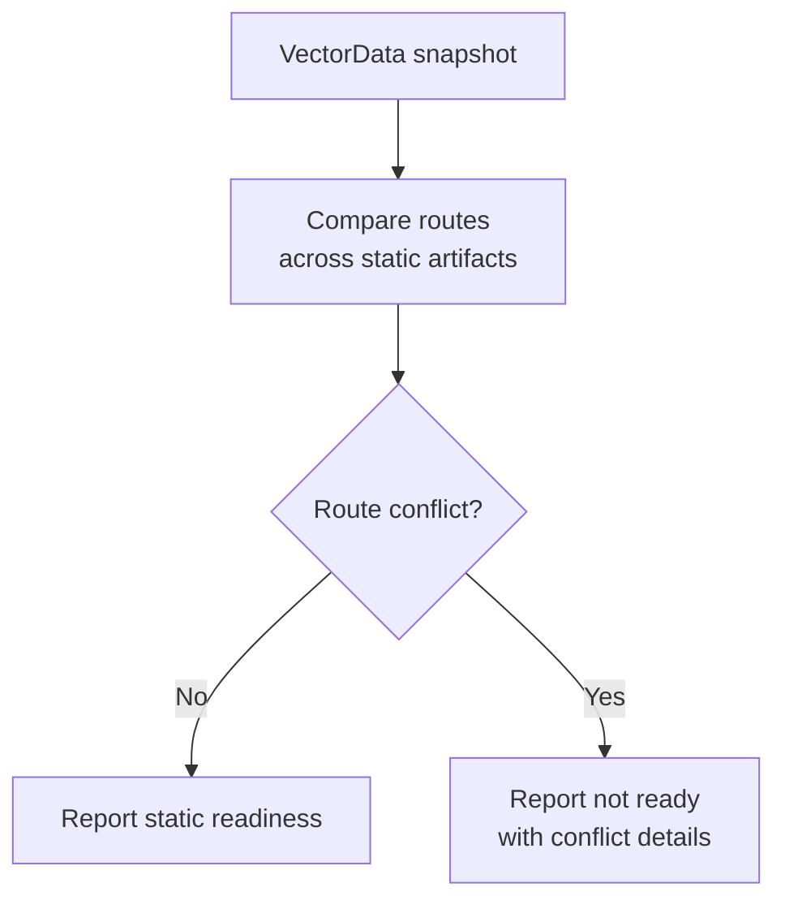
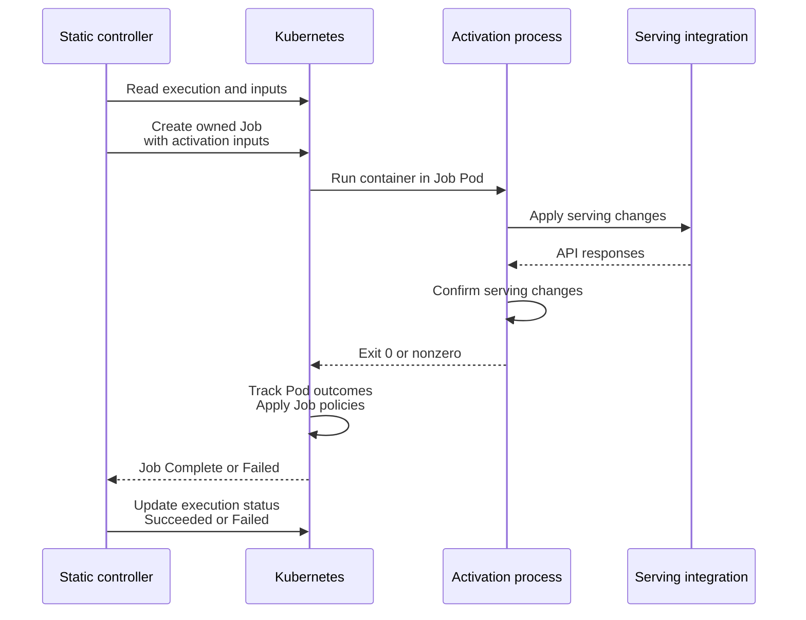
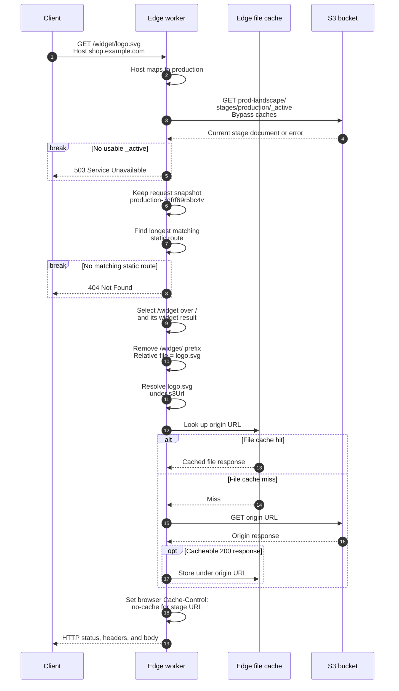
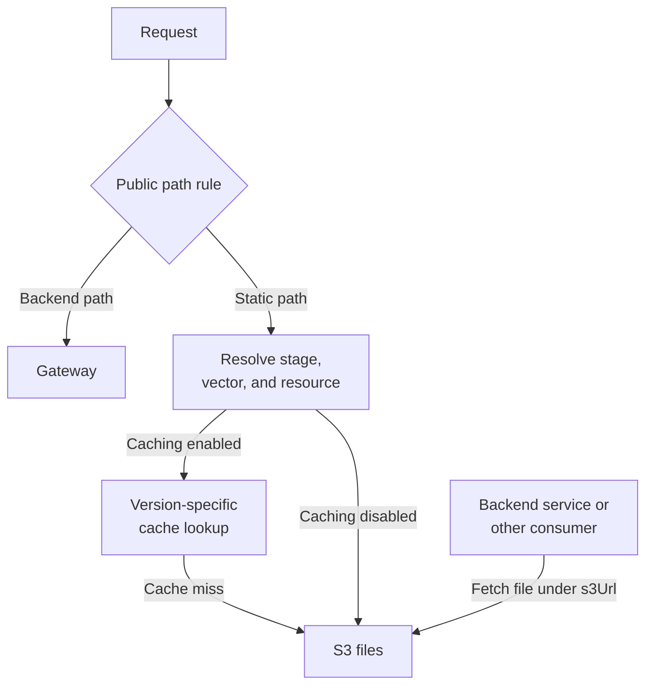

# ADR-0039: A static content deployer for Konfidence

<AdrHeader />

## Static storage, configurable serving at the edge

The static content deployer uploads artifact resources to S3 for an administrator-provided CDN, proxy, or reverse proxy to serve. Backend services and consumers deployed from other artifact types can also read those files directly. Activation depends on the user's serving setup, routing rules, and S3 configuration.

## Put activation in user-owned Jobs

Activation runs a Kubernetes Job configured through a user-owned `ActivationTaskRegistration`. The user controls the registration, Job image, commands, credentials, and integration settings. The Job can configure S3, a CDN, a proxy, or a reverse proxy as needed to activate the vector.

Konfidence will provide two starter Job templates:

1. Atomic stage switches through S3.
2. Configure edge routing through CDN API calls.

Both options use the same registration and execution contract. Users can adapt the templates for their serving setup or write their own Job. The CDN provider for option 2 is still to be selected.

### Who owns each operation

| Owner | Responsibility |
| --- | --- |
| Administrator | Provide storage and serving infrastructure, DNS, HTTPS, credentials, and public path assignments. Create and maintain the activation registration. |
| Static deployer | Store artifact resources, publish deployment results, check cross-artifact route conflicts, and create and monitor activation Jobs through its own controllers. |
| User-configured Job | Apply S3 and serving configuration and check that the changes succeeded. |

## Deploy static content to S3

### Static resources with optional routes

An artifact of type `static.konfidence.cloud/v1alpha1` contains one or more static content resources, each packaged as a tar archive, optionally gzip-compressed. Each resource can declare an optional public route through its labels. This OCM component constructor packages a directory for `storefront` and embeds a prebuilt archive for `widget`:

```yaml
components:
  - name: common.konfidence.cloud/example/shop
    version: 1.2.0
    provider:
      name: shoppy-shoppers
    resources:
      - name: konfidence-manifest
        type: cloud.konfidence.artifact.manifest
        input:
          type: File/v1
          path: ./konfidence-manifest.json
          mediaType: application/json

      - name: storefront
        type: static.konfidence.cloud/v1alpha1
        version: 1.2.0
        labels:
          - name: static.konfidence.cloud/v1alpha1
            value:
              route: /
        input:
          type: Dir/v1
          path: ./dist/storefront
          compress: true
          reproducible: true
          preserveDir: false

      - name: widget
        type: static.konfidence.cloud/v1alpha1
        version: 1.2.0
        labels:
          - name: static.konfidence.cloud/v1alpha1
            value:
              route: /widget
        input:
          type: File/v1
          path: ./dist/widget.tar.gz
          mediaType: application/x-tar+gzip
```

OCM resolves these [directory and file inputs](https://ocm.software/docs/reference/input-and-access-types/#input-types) during publication and stores their content alongside the component descriptor as `LocalBlob/v1` resources. It generates the blob references and digests. With `preserveDir: false`, the storefront's files sit directly at the archive root. This layout is required so the archive root maps directly to the S3 directory named after the resource.

The `konfidence-manifest.json` file contains:

```json
{
  "type": "static.konfidence.cloud/v1alpha1",
  "allowReuse": true
}
```

The deployer will also support static resources referenced through OCM's [`S3/v2` access method](https://ocm.software/docs/reference/input-and-access-types/#s3v2-access). An existing widget archive can be referenced by replacing its `input` with:

```yaml
access:
  type: S3/v2
  region: eu-central-1
  bucketName: build-artifacts
  objectKey: shop/1.2.0/widget.tar.gz
  version: "<S3 object VersionId>"
  mediaType: application/x-tar+gzip
```

The reference selects one archive object; the optional `version` pins its S3 object version. The deployer downloads the archive and uploads its extracted files to the configured target.

OCM also specifies [S3-backed component repositories](https://github.com/open-component-model/ocm-spec/blob/main/doc/04-extensions/03-storage-backends/s3.md), which store both component descriptors and local resource blobs in S3. For users who keep all OCM content in S3, artifact resources could reference the stored objects directly, allowing OCM content and deployed static files to share one storage system. Paving the way for an S3 only artifact reference machinery used by core - no OCI required.

### Configure the S3 target

`DeploymentTarget.spec.parameters` references a deployer-owned `StaticDeploymentConfig` through `apiGroup`, `kind`, and `name`, following the [DeploymentTarget contract](https://github.com/konfidence-project/konfidence/blob/2f37342f0a2b113ffdc8eae52fec2aa3982c7215/conformance/specs/deployer.md#2-deploymenttarget). The configuration holds storage settings and references a Secret containing credentials. Both referenced resources live in the target's landscape namespace.

```yaml
apiVersion: konfidence.cloud/v1alpha1
kind: DeploymentTarget
metadata:
  name: static-prod
  namespace: kden-l-prod-fz8g86s6
spec:
  artifactType: static.konfidence.cloud/v1alpha1
  parameters:
    apiGroup: static.konfidence.cloud
    kind: StaticDeploymentConfig
    name: static-prod
---
apiVersion: static.konfidence.cloud/v1alpha1
kind: StaticDeploymentConfig
metadata:
  name: static-prod
  namespace: kden-l-prod-fz8g86s6
spec:
  storagePathPrefix: prod-landscape
  s3:
    endpoint: https://s3.eu-central-1.amazonaws.com
    bucket: static-assets
    region: eu-central-1
    usePathStyle: false
    credentialRef:
      name: static-prod-s3-creds
```

`StaticDeploymentConfig.spec.storagePathPrefix` defaults to an empty string, which uses the bucket root. A trailing slash is optional, so `prod-landscape` and `prod-landscape/` identify the same storage prefix. Landscapes sharing a bucket need distinct prefixes.

The S3 client uses the configured API `endpoint`, signing `region`, and `usePathStyle` setting for AWS S3 or an S3-compatible service such as MinIO, Ceph RGW, or Cloudflare R2. `usePathStyle` defaults to `false` for virtual-hosted bucket addressing; `true` uses `<endpoint>/<bucket>/<key>`. The region is a provider-specific signing value. For example, MinIO can use `endpoint: https://minio.example.com`, `region: us-east-1`, and `usePathStyle: true`.

#### Why a configuration CRD

We choose a versioned configuration CRD over a direct Secret reference to give non-secret settings a typed schema with validation and defaults. The static deployer can evolve this API independently of Konfidence core, while users manage configuration through GitOps and rotate credentials through the referenced Secret. This adds a deployer-owned CRD to ship and maintain.

The deployer validates the configuration and revalidates the target when it or the referenced Secret changes. Each `ArtifactDeployment` retains its resolved storage endpoint, bucket, and prefix for subsequent operations and cleanup.

### Upload files, publish deployment results

The deployers provided pre OCM upload checks validate each artifact's static resource names and optional route metadata. It rejects duplicate names or route values within the artifact.

The deployer extracts each static artifact resource beneath the configured `storagePathPrefix`, using the deployment and resource directories shown below. It owns those files under `_k/`. The example also shows the `_active` stage document created by [option 1](#option-1-atomic-stage-switches-through-s3):

```text
prod-landscape/                         # configured storage prefix
├── _k/
│   └── shop-1.2.0-k3h9d7bq2f/          # ArtifactDeployment name
│       ├── storefront/                 # artifact resource name
│       │   ├── index.html
│       │   └── assets/...
│       └── widget/                     # artifact resource name
│           ├── widget.html
│           └── assets/...
└── stages/
    └── production/
        └── _active                    # written by the activation Job
```

After deploying an artifact, the static deployer publishes one deployment result per static resource in `ArtifactDeployment.status.deploymentResult`. Each result uses the resource's name and optional `route`; the deployer generates `assetBase` and `s3Url` from the storage layout. This JSON shows the deployment result for the `widget` resource:

```json
{
  "name": "widget",
  "type": "static.konfidence.cloud/v1alpha1",
  "spec": {
    "assetBase": "/shop-1.2.0-k3h9d7bq2f/widget/",
    "s3Url": "https://static-assets.s3.eu-central-1.amazonaws.com/prod-landscape/_k/shop-1.2.0-k3h9d7bq2f/widget/",
    "route": "/widget"
  }
}
```

- `route` is optional and declares the resource's public mount path. Serving implementations may use or ignore it. When used, the serving configuration controls matching; longest-prefix matching is suggested. Files remain accessible through `s3Url` whether or not `route` is declared or used.
- `assetBase` is the resource's extracted directory relative to the `_k/` content root beneath the configured storage prefix. Its leading slash denotes that content root.
- `s3Url` is the absolute S3 URL prefix for the resource's files, with a trailing slash. Consumers resolve relative file paths beneath it and use their own credentials if the bucket is private. Backend services and consumers deployed from any artifact type can use it to read static content directly from S3.

## Catch route conflicts and report readiness

The static deployer reports `ArtifactDeployment.Ready` after uploading the artifact's static resources and publishing their results.

The static deployer's `VectorData` controller checks only for duplicate declared `route` values across artifacts in the immutable snapshot, using deployment results of type `static.konfidence.cloud/v1alpha1`. It compares route strings for exact equality, independently of Job templates and serving code.

Two resources declaring `/widget` are a conflict and block readiness. Nested prefixes such as `/` and `/widget` are valid because longest-prefix matching selects a single most-specific route. Omitted routes do not participate in the check.

The controller reports only the static deployer's readiness contribution, once for the combined static result set and tied to the `VectorData` identity and generation it checked. No conflicts means ready. A conflict produces a not-ready report identifying the route and the conflicting artifact components and resources.



### Serving VectorData at the edge

With either activation approach described below, browsers and other clients can retrieve `VectorData` from S3, a CDN, or a proxy. The activation Job publishes the data to the configured serving infrastructure, which can expose it through a route such as `GET /k_vector`. Client-side JavaScript can then read authored configuration directly and evaluate feature flags with an OpenFeature SDK whose provider uses the returned data.

## Activate vectors with Kubernetes Jobs

### Job templates and activation inputs

The user creates an `ActivationTaskRegistration` in the landscape namespace, separately from the `DeploymentTarget`. Its type matches the artifact type, `static.konfidence.cloud/v1alpha1`, and selects the static deployer's activation controller. S3 and serving settings, including Secret references, belong to the Job configuration. The Job image contains the integration-specific logic.

The controller mounts a read-only `/konfidence/activation.json` file in the Job containing:

- Activation identity and namespace.
- Stage name and `StageVersion` reference from `VectorActivation`.
- Vector deployment ID from `VectorDeployment.metadata.name` and the vector's OCM reference.
- The selected vector's `features` and `authored` data.
- Its `deploymentResults`, grouped by artifact.

The controller reads `features`, `authored`, and deployment results from the selected vector's immutable `VectorData.spec`.

The stage input lets the Job map stages to serving targets. Deployment results locate each artifact resource's files; the other vector data is available for serving configuration.

In this illustrative registration, `spec.spec.jobTemplate` contains a Kubernetes `JobSpec`. The image is a placeholder for a supplied template image or the user's implementation:

```yaml
apiVersion: konfidence.cloud/v1alpha1
kind: ActivationTaskRegistration
metadata:
  name: activate-static
  namespace: kden-l-prod-fz8g86s6
spec:
  type: static.konfidence.cloud/v1alpha1
  spec:
    jobTemplate:
      backoffLimit: 2
      activeDeadlineSeconds: 300
      template:
        spec:
          restartPolicy: Never
          containers:
            - name: activate
              image: registry.example.com/platform/activate-static:1
              args: ["--input", "/konfidence/activation.json"]
              envFrom:
                - secretRef:
                    name: static-activation-settings
```

### Run the Job, report the outcome

For each `ActivationTaskExecution` of type `static.konfidence.cloud/v1alpha1`, the static controller reads the linked `VectorActivation` and validated `VectorData`. It validates the Job template carried by the execution and creates the Job directly in the execution's namespace. The execution owns the Job through a Kubernetes owner reference.

The activation process runs inside the Job's Pod. It receives the serving API responses and reports success or failure through its exit code:



The process exits `0` only after confirming its serving changes; a nonzero exit code indicates failure. Kubernetes determines the Job's terminal condition from Pod outcomes and the template's completion, retry, and deadline settings.

The static controller maps Job `Complete=True` to execution `Succeeded=True`, and Job `Failed=True` to execution `Failed=True`. It reuses the Job during reconciliation and does not restart completed executions. The commands must tolerate retries.

A failed Job may have made external changes; reporting failure does not undo them. The `_active` starter in option 1 gives routing a single commit point through an atomic S3 write.

## Switch traffic with starter Jobs

Options 1 and 2 are editable starter Job templates with input handling, configuration examples, and completion checks. They run through the same registration and Job lifecycle. Each Job runs only on activation and overwrites the stage's previous serving configuration and vector data in place.

### Option 1: Atomic stage switches through S3

The `_active` starter writes a JSON file at `stages/<stage>/_active` beneath the configured storage prefix in S3. This file tells the serving handler which vector is active and how public routes map to files in S3. Its deployment results contain each static resource's optional `route` and the `s3Url` where its files live.

The file also carries the vector's `features` and `authored` data. Its `vectorId` is the selected `VectorDeployment.metadata.name`. In this production example, `/` resolves to the `storefront` resource and `/widget` to `widget`:

```json
{
  "vectorId": "production-7dfrf69r5bc4v",
  "features": {
    "express-checkout": {
      "enabled": true
    },
    "recommendations": {
      "enabled": false
    }
  },
  "authored": {
    "currency": "EUR",
    "locale": "en-GB",
    "pageSize": 24
  },
  "deploymentResults": {
    "common.konfidence.cloud/example/shop": [
      {
        "name": "storefront",
        "type": "static.konfidence.cloud/v1alpha1",
        "spec": {
          "assetBase": "/shop-1.2.0-k3h9d7bq2f/storefront/",
          "s3Url": "https://static-assets.s3.eu-central-1.amazonaws.com/prod-landscape/_k/shop-1.2.0-k3h9d7bq2f/storefront/",
          "route": "/"
        }
      },
      {
        "name": "widget",
        "type": "static.konfidence.cloud/v1alpha1",
        "spec": {
          "assetBase": "/shop-1.2.0-k3h9d7bq2f/widget/",
          "s3Url": "https://static-assets.s3.eu-central-1.amazonaws.com/prod-landscape/_k/shop-1.2.0-k3h9d7bq2f/widget/",
          "route": "/widget"
        }
      }
    ]
  }
}
```

Activation replaces the whole `_active` file with one S3 `PutObject`. The referenced files are already deployed. Readers get either the complete old or new document, so publication of the routing data is atomic.

The Job writes `_active` without cache-control metadata and completes after S3 confirms the write.

#### Option 1: Serve `/k_vector` from the selected snapshot

For a stage-route `GET /k_vector`, the worker reads `_active` uncached and returns its client-facing fields as JSON. Browsers should not cache the data either.

#### Option 1: Trace a file request through an edge worker

The administrator's CDN, proxy, or reverse proxy uses a handler or edge worker to read `_active` and route requests. For every request through a stage route such as `/widget/logo.svg`, the worker must fetch `_active` directly from S3, bypassing worker and CDN caches. The worker enforces this through its fetch and cache configuration and keeps the snapshot only for the current request.

This example uses longest-prefix matching. The worker maps `shop.example.com` to stage `production`, bucket `static-assets`, and storage prefix `prod-landscape`. Static requests reach the worker before file-cache lookup. The activation Job has already published the `production-7dfrf69r5bc4v` document shown above.

The worker selects the stage default through `_active`:



The resolved origin URL is also the file-cache key in this example:

```text
https://static-assets.s3.eu-central-1.amazonaws.com/prod-landscape/_k/shop-1.2.0-k3h9d7bq2f/widget/logo.svg
```

`_active` is routing and configuration JSON, typically much smaller than the artifact files. The worker never caches `_active` or the stage selection. It can cache immutable artifact files at the edge under their deployment-specific URLs across activations. On a file-cache hit, only `_active` is fetched from S3; a miss also fetches the selected file. Private-bucket reads use the worker's S3 credentials.

The browser caches by the URL it requested. `/widget/logo.svg` can resolve to different files after activation, so the worker returns `Cache-Control: no-cache` for this URL. The browser may store the response but must revalidate before reuse.

Browser-visible deployment-specific URLs resolve to the same files regardless of `_active`, so they can use a long `max-age` with `immutable`. An internal S3 rewrite does not change the browser's cache key. Requests that have already selected a snapshot finish with it.

### Option 2: Configure edge routing through CDN API calls

In option 2, the CDN's deployed configuration holds the stage's active vector, route mappings, and client-facing vector data. The activation Job reads `/konfidence/activation.json` and translates its static deployment results into native CDN routing rules or worker configuration. It publishes the routes and vector data through the CDN's API. The artifact files remain in S3.

For stage `production`, activating `production-7dfrf69r5bc4v` configures:

- `/` to resolve files under the `storefront` result's `s3Url` prefix.
- `/widget` to resolve files under the `widget` result's `s3Url` prefix.
- `/k_vector` to serve the same vector's client-facing data.

The Job uses its configured CDN target and credentials to apply the update. Its process exits `0` after the template's provider-specific completion check confirms that the requested configuration is applied. The CDN determines update atomicity and propagation across edge locations.

The template includes the provider API calls, required settings, and completion checks. The example CDN is still to be decided. Users can adapt the Job to configure a proxy or reverse proxy through an API or by writing configuration and triggering a reload.

#### Option 2: Resolve requests from CDN configuration

A request for `shop.example.com/widget/logo.svg` uses the CDN's installed stage configuration to select the `widget` resource and resolve `logo.svg` under its `s3Url`. The CDN checks its file cache under that deployment-specific URL and fetches the file from S3 only on a miss. Stage selection uses the deployed CDN configuration.

#### Option 2: Serve `/k_vector` through CDN routing

The Job publishes the client-facing `VectorData` JSON through the CDN provider's API, for example in worker configuration or the provider's distributed key-value store. The configuration or data uses stable keys based on the stage or public hostname. The edge handler serves `/k_vector` from that data.

Each subsequent activation replaces the complete routing and vector-data snapshot at the same keys. Routes and values absent from the new vector are removed by that replacement.

## Route by vector, cache by version

With either option, the administrator's public path rules send backend requests to a, potentially konfidence powered, gateway and static requests to the configured CDN, proxy, or reverse proxy. The administrator can assign any path or set of paths to backend gateways.

For a static request, the serving integration selects the stage, vector, and artifact resource before any file-cache lookup. Caching is optional. Other consumers can fetch files directly through `s3Url`:



The selected vector determines which artifact resource a route serves and the data returned by `/k_vector`. Directory indexes, trailing-slash redirects, SPA fallbacks, and browser-safe data projection belong to the serving integration.

Edge cache entries use version-specific object paths or an equivalent immutable key. The serving integration controls edge-cache lifetimes and browser-facing headers. Mutable public URLs must revalidate through vector selection; immutable, browser-visible URLs can use long-lived caching.

## Garbage collection and delayed S3 cleanup

Shared artifact files remain while vectors reference their `ArtifactDeployment`. When the deployment is marked for deletion, the static deployer deletes all S3 objects in that deployment's directory under `_k/` before removing its finalizer. Failed deletions keep the finalizer in place for retry.

A future opt-in cleanup delay could keep the finalizer and S3 files in place for a configurable grace period after deletion is requested. Some edge locations may still use the previous routing configuration while updates propagate, and in-flight requests may still need the old vector's files. Keeping those files available lets late edge cache misses fetch them from S3 instead of returning 404s. After the grace period, the controller would delete the files and remove the finalizer.

## Build the controllers and starter Jobs

The static deployer implements and ships its own `VectorData` and activation controllers. The activation controller manages Job creation, activation inputs, monitoring, and status reporting through the Kubernetes API. The `VectorData` controller checks cross-artifact routes and reports the static deployer's contribution through the [per-deployer VectorData readiness contract](https://github.com/konfidence-project/konfidence/issues/395).

The implementation includes the `StaticDeploymentConfig` CRD and both starter Job templates. The CDN provider for option 2 remains to be selected.

## A vector sticky future

Vector stickiness would keep a page or browser session on one vector while new sessions follow a changed stage default. Possible approaches include:

- Versioned URLs for artifact files and vector data, with the application carrying its vector selection into subsequent requests.
- A session cookie that lets the edge or gateway preserve the vector selection while public URLs stay stable.

For full end-to-end stickiness, Konfidence would need to provide a sticky gateway that preserves the same vector across page loads, static files, `/k_vector`, and API calls. It would coordinate CDN and backend routing, set `X-Vector-ID` for backend requests, and rely on services forwarding that ID to downstream calls. Keeping vectors alive across runtimes until sessions time out. Versioned asset URLs (we have them already with this ADR) alone cannot keep backend calls on the same vector.

This is future work. If at all. Session expiry and vector retention must be coordinated so that a session's files, configuration, and services remain available for its lifetime.

## Design and API references

- [ADR-0012: Activation controller](./adr-0012-activation-controller.md)
- [Activation task registration API](https://github.com/konfidence-project/konfidence/blob/main/api/v1alpha1/activationtaskregistration_types.go)
- [Activation task execution API](https://github.com/konfidence-project/konfidence/blob/main/api/v1alpha1/activationtaskexecution_types.go)
- [Amazon S3 atomic object updates](https://docs.aws.amazon.com/AmazonS3/latest/userguide/Welcome.html#ConsistencyModel)
- [HTTP cache-control directives](https://developer.mozilla.org/en-US/docs/Web/HTTP/Reference/Headers/Cache-Control)
- [OpenFeature Web SDK and provider interface](https://openfeature.dev/docs/reference/sdks/client/web/)
- [OpenFeature Node.js SDK and provider domains](https://openfeature.dev/docs/reference/sdks/server/javascript/)
- [OpenFeature Remote Evaluation Protocol](https://openfeature.dev/docs/reference/other-technologies/ofrep/)
- [Konfidence runtime vector-data service](https://github.com/konfidence-project/kubernetes-landscape-orchestrator/blob/main/cmd/vectordata/vector_data_service.go)
