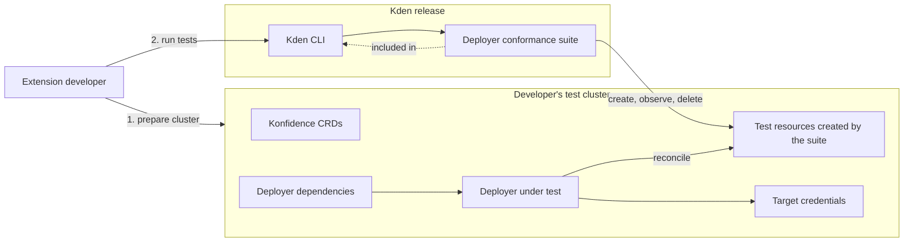
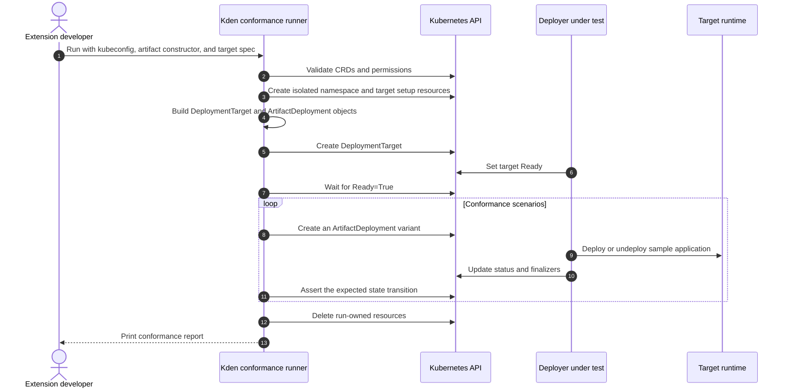

# ADR-0040: Execute conformance tests for a deployer implementation

<AdrHeader />

## Context

Konfidence deployers can be developed outside the Konfidence repositories. Extension developers need a repeatable way to verify that their deployer implements the deployer specification without recreating its test cases.

The conformance suite cannot create every input without help from the extension developer:

- Konfidence does not know the kind of artifact handled by the deployer. The deployer author defines its artifact packaging contract and knows what a valid application artifact looks like.
- The deployer author defines the parameters used to connect to a deployment target.
- The deployer may require controllers, credentials, or runtime services which Konfidence cannot install generically.

Requiring developers to create all test resources manually is not acceptable either. It introduces setup races, makes destructive tests unsafe, and forces developers to understand unrelated Konfidence concepts. The test runner must therefore own the test lifecycle while accepting the minimum deployer-specific inputs from the extension developer.

## Decision

### Developer workflow

An extension developer performs two steps:

1. **Prepare a test cluster** containing the Konfidence CRDs, the deployer under test, and the deployer's dependencies.
2. **Run the conformance suite** with a kubeconfig, the artifact's OCM component constructor, and a deployment-target spec.

The developer does not author or manually create a Project, Landscape, Stage, Vector, test namespace, `DeploymentTarget`, or `ArtifactDeployment`. The inputs are the same artifact authoring file used for publication and the deployer-specific target configuration. The conformance runner translates those inputs into Konfidence resources and removes the resources after the tests.



### Preparing the cluster

The extension developer can bring an existing Kubernetes cluster or use the Konfidence development helper to create a local Kind cluster.

For an existing cluster, the developer must:

1. install the Konfidence CRDs matching the selected conformance-suite version;
2. install any standard or provider-specific dependencies needed by the deployer;
3. install and configure the deployer under test; and
4. ensure the deployer can access its target runtime and required credentials.

For local development, `hack/conformance/cluster-setup.sh` creates a Kind cluster, installs the matching Konfidence CRDs, and writes a kubeconfig. The extension developer still installs the deployer and any deployer-specific dependencies. The helper cannot install an arbitrary extension.

The complete Konfidence control plane is not required for base deployer conformance. The conformance runner acts as the producer of `DeploymentTarget` and `ArtifactDeployment` resources. This keeps failures in unrelated controllers out of the deployer test result.

### Inputs supplied by the extension developer

The conformance command requires the following inputs:

| Input | Purpose |
| --- | --- |
| Kubeconfig | Selects and authenticates to the cluster containing the deployer under test. |
| OCM component constructor | The same artifact YAML supplied to `kden artifact push`; it describes a real sample application according to the deployer's artifact contract. |
| Deployment-target spec | Contains only `artifactType` and optional deployer-specific `parameters`, without Kubernetes resource metadata. |
| Target setup manifests (optional) | Supply namespaced Secrets, ConfigMaps, or provider resources referenced by the target. |

The artifact and target spec should be stored in the deployer's repository under a directory such as `conformance/`. The same files are used locally and in continuous integration.

#### Artifact component constructor

The developer supplies the OCM component constructor they would use to publish the artifact and later reference it from a Vector. The constructor must contain:

- the vendor-owned artifact type supported by the deployer;
- exactly one `konfidence-manifest` resource;
- all deployer-specific resources and payloads required to deploy a minimal application; and
- no dependency on a Project, Landscape, Stage, or Vector created outside the test run.

The suite does not connect to the developer's OCM repository. It reads the constructor and its local manifest files directly. Deployer-consumed resources must therefore use external, self-contained `access` specifications. A deployer-consumed resource using a local `input` would require the suite to publish or host that payload and is rejected during preflight.

```yaml
components:
  - name: example.com/conformance-app
    version: 1.0.0
    provider:
      name: example
    resources:
      - name: konfidence-manifest
        type: cloud.konfidence.artifact.manifest
        relation: local
        input:
          type: file/v1
          path: ./manifest.json
      - name: application
        type: example-application
        version: 1.0.0
        relation: external
        access:
          type: ociArtifact
          imageReference: registry.example.com/conformance-app:1.0.0
```

The referenced `manifest.json` contains the artifact type and reuse policy:

```json
{
  "type": "app.example.com",
  "allowReuse": false
}
```

Paths in local manifest inputs are resolved relative to the component constructor. The application should be small, deterministic, accessible to the target, and require no manual interaction. It only needs to exercise deployment, status reporting, repeated reconciliation, and deletion.

#### Deployment-target spec

The target input contains only the desired spec. It selects the same artifact type and contains parameters understood by the deployer. The developer does not provide `apiVersion`, `kind`, `metadata`, a namespace, or a surrounding `spec` property.

```yaml
artifactType: app.example.com
parameters:
  apiGroup: ""
  kind: Secret
  name: conformance-target-credentials
```

`spec.parameters` is optional when the deployer can use an installation-wide or local default. If it references a namespaced resource, that resource must be part of the conformance setup and be created in the test namespace before the target. The runner accepts one resource per target setup file and rewrites its namespace. Secret values must be supplied by the test environment and must never be written to test output.

The type in the artifact's `konfidence-manifest` and the target spec must match. A mismatch is a command-input error and the tests do not start.

### Running the tests

The conformance suite is released with Kden and exposed through the Kden CLI:

```shell
kden conformance deployer run \
  --kubeconfig ./conformance.kubeconfig \
  --artifact-constructor ./conformance/component-constructor.yaml \
  --deployment-target-spec ./conformance/deployment-target-spec.yaml \
  --target-setup ./conformance/target-secret.yaml
```

`--target-setup` is repeatable and is omitted when the target needs no referenced resources.

The suite can also be executed as a Go binary while developing Konfidence itself. Both entry points use the same suite package and execute the same tests; the Kden CLI is the supported interface for extension developers.

Before executing Ginkgo, the command validates:

- access to the cluster
- the presence and compatible versions of the required CRDs
- permission to create and delete the test resources
- that the component constructor and target spec can be decoded
- that the constructor contains exactly one component and one valid `konfidence-manifest`
- that the artifact manifest and target spec declare the same valid artifact type
- that referenced target setup resources are available

A failed preflight exits before deploying the sample application and explains how to correct the input or cluster setup. Missing resources are setup failures, not pending tests.

### What the conformance runner does

For each invocation, the runner:

1. generates a unique run identifier
2. creates an isolated namespace labelled as a conformance landscape
3. creates target credentials and other supplied setup resources in that namespace
4. creates the `DeploymentTarget` from the supplied spec
5. waits for the deployer to report `DeploymentTarget.status.conditions[Ready]=True`
6. creates an `ArtifactDeployment` from the component constructor and then creates controlled variants of it
7. executes the conformance scenarios with finite reconciliation timeouts
8. records passed, failed, and skipped test identifiers
9. deletes all resources owned by the run



The generated valid `ArtifactDeployment` is the baseline for all scenarios. The runner maps component name and version, reads the Konfidence manifest and task manifests from their local files, and copies external resource access specifications into the component resources. It changes only fields required by a scenario, for example by creating an unsupported artifact type, removing required resources, repeating reconciliation, or deleting an artifact. It must not guess how to rewrite the provider-specific application payload. Tests requiring such a transformation need an explicit provider fixture extension and are skipped with a reason when it is absent.

### Waiting, failure reporting, and cleanup

The runner performs bounded waits for asynchronous reconciliation. The extension developer does not need to insert sleeps or wait for the target manually. Reconciliation and polling timeouts are configurable from the command line.

When a resource does not reach the expected state, the report includes:

- resource kind, namespace, and name;
- expected condition and status;
- last observed conditions, reasons, and messages;
- elapsed time and configured timeout; and
- whether the failure occurred during setup, a conformance scenario, or cleanup.

The command returns a non-zero exit status when preflight, conformance, or cleanup fails. It supports a machine-readable report for CI in addition to human-readable output. Kubeconfig contents, Secret values, and sensitive target parameters are always redacted.

Cleanup is attempted after success, failure, or interruption. Resources are selected by the unique run label; the runner never deletes unrelated resources. If a finalizer correctly prevents deletion because the runtime is unavailable, the report lists the retained objects and explains how the developer can restore access and retry cleanup.

## Alternatives considered

### Require pre-created Konfidence resources

Rejected. It turns the suite into a passive validator, introduces readiness races, and prevents target mutation and deletion tests from running safely.

### Require a complete Konfidence project hierarchy

Rejected. Project, Landscape, Stage, and Vector orchestration are outside the deployer contract. Requiring them increases setup time and makes deployer results depend on unrelated controllers.

### Let the runner install the deployer

Rejected. Third-party deployers have no common installation or dependency contract. Installing and configuring the implementation under test remains the extension developer's responsibility.

### Provide one universal application fixture

Rejected. A Kubernetes workload cannot represent deployers for object stores, CDNs, cloud services, Wasm runtimes, or other destinations. The extension developer provides one minimal valid artifact using their own packaging contract.

## Consequences

- An extension developer maintains their normal OCM component constructor, one small deployment-target spec, and an installation procedure for their deployer.
- The developer does not need to know the schemas or metadata conventions of `ArtifactDeployment` and `DeploymentTarget`.
- The developer does not need to manually create Konfidence hierarchy or test-case resources.
- Local and CI runs use the same command and fixture files.
- Tests are deterministic because the runner controls resource ordering and readiness waits.
- Destructive tests are isolated because the target and artifacts belong to one test run.
- Generic tests can derive structural invalid cases from the valid fixture, but provider-specific payload mutations require an explicit extension.
- Base conformance requires the Konfidence CRDs but not the complete Konfidence control plane.
- The suite reports missing prerequisites as actionable failures rather than pending tests.

## Implementation direction

1. Keep one Go suite package shared by the Kden CLI and the development binary.
2. Load an OCM component constructor and a deployment-target spec from YAML files and translate them into the corresponding test resources.
3. Load namespace-rewritten target setup manifests, including Secrets and provider-specific resources.
4. Create the namespace, target, artifact variants, readiness waits, and cleanup inside the runner.
5. Emit human-readable and machine-readable reports with stable conformance test identifiers.
6. Provide `hack/conformance/cluster-setup.sh` for the optional local Kind workflow.
