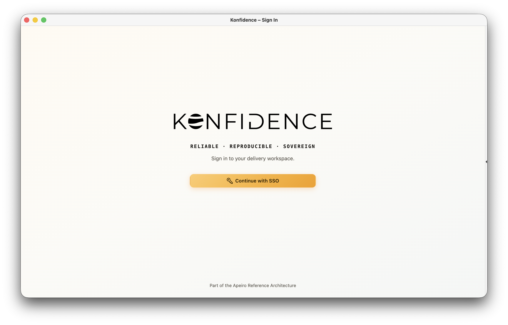

# ADR-0041: Documentation maintenance and quality checks

<AdrHeader />


## Proposal

To improve documentation quality and reduce manual checks for writing conventions,
Markdown structure, and broken links, we propose a documentation maintenance
strategy supported by automated checks. This ADR introduces Vale, markdownlint-cli2,
and lychee alongside the existing VitePress build to support these goals and give
reviewers more time to assess technical accuracy and whether readers can complete
their tasks.

## Build on existing VitePress features

VitePress provides a
[built-in check for links to missing internal pages](https://vitepress.dev/reference/site-config#ignoredeadlinks).
This check is already enabled for our documentation. It reports broken page
references during the build, so authors can fix them before publication instead
of checking every target page manually. lychee would extend this coverage to
heading fragments and the availability of external URLs.

VitePress also reads frontmatter and makes the parsed metadata available through
[page-data hooks](https://vitepress.dev/reference/site-config#transformpagedata)
and [content loaders](https://vitepress.dev/guide/data-loading#createcontentloader).
Our ADR catalogue already uses content loaders to read these fields. If needed,
developers can use this existing access to add checks for empty descriptions or
duplicate ADR IDs without adding another parser.

This reuse avoids a separate metadata toolchain. It does not replace checks for
our writing rules, Markdown conventions, or the remaining link problems below.

## Three tools for the remaining checks

Each proposed tool covers a different part of the review:

| Tool | Additional checks | Work it takes off authors and reviewers |
| --- | --- | --- |
| [Vale](https://vale.sh/) | Terminology, sentence case, spelling, and configured writing rules. | Repeated corrections to wording and capitalization across pages. |
| [markdownlint-cli2](https://github.com/DavidAnson/markdownlint-cli2) | Heading levels, lists, tables, code fence labels, missing image alternative text, and undefined link references. | Manual inspection of Markdown structure and code block markup. |
| [lychee](https://github.com/lycheeverse/lychee) | Links, heading fragments, and static image references in the built site, plus external URL checks. | Manually following links and checking assets, including on unchanged pages. |

## Practical benefits for the Konfidence docs

### Consistent terms and sentence case

Configure Vale around our [style guide](../styleguide.md) and
[glossary](../../reference/glossary.md). For example, the proposed rules would flag
these illustrative inconsistencies:

| Text to flag | Preferred text | Rule |
| --- | --- | --- |
| Build Vectors With Konfidence | Build vectors with Konfidence | Sentence case in headings. |
| Deploy Artifacts in a Vector. | Deploy artifacts in a vector. | Lowercase concept names within a sentence. |
| Configure konfidence | Configure Konfidence | Consistent product name. |

Vale supports [sentence-case checks](https://docs.vale.sh/checks/capitalization)
and [preferred-term replacements](https://docs.vale.sh/checks/substitution).
Preserve capitalization at sentence starts, other proper names such as Kubernetes,
and exact resource names such as `VectorTemplate`. Code blocks and inline code
are [ignored by default](https://docs.vale.sh/formats/markdown).

Vale's [spellchecker](https://docs.vale.sh/checks/spelling) also lets us maintain
exceptions for product names and technical terms. The same editorial rules can
check wording in [frontmatter fields](https://docs.vale.sh/formats/front-matter)
such as `title` and `description`; they do not validate field types or unique IDs.

### Complete code block markup and consistent structure

An installation guide can build successfully even if a command block has no
language label or a heading skips from level two to level four. markdownlint
can flag missing `bash` or `yaml` labels, skipped heading levels, and malformed
tables. These checks support the style guide without a reviewer inspecting each
block. The relevant rules are
[MD040 for code fence labels](https://github.com/DavidAnson/markdownlint/blob/main/doc/Rules.md#md040---fenced-code-blocks-should-have-a-language-specified),
[MD001 for heading levels](https://github.com/DavidAnson/markdownlint/blob/main/doc/Rules.md#md001---heading-levels-should-only-increment-by-one-level-at-a-time),
and [MD056 for table columns](https://github.com/DavidAnson/markdownlint/blob/main/doc/Rules.md#md056---table-column-count).
They do not check whether a command itself works.

### Working images and descriptive links

The documentation currently contains few screenshots, for example in the
[Quickstart](../../getting-started/quickstart.md). As the UI and its documentation
evolve, we expect more screenshots. Automated image checks will help catch
missing files and broken references as that collection grows. For example:

```markdown

```

- **lychee** checks whether the image target exists in the built site.
- **markdownlint** checks whether alternative text is present; this example has it.
- **Vale** can check its wording, including the spelling of Konfidence.

VitePress can already catch missing imported images during the build. lychee adds
a check of static image references in the output, including external image URLs.

A link to the Quickstart's dashboard section illustrates another distinction:

```markdown
[Click here](../../getting-started/quickstart.md#open-the-dashboard)
```

Vale can flag “Click here” using a
[rule for link text](https://docs.vale.sh/topics/scopes#inline-elements), suggesting
a descriptive label such as “Open the dashboard”. lychee checks the target and
its `open-the-dashboard` fragment. This catches a renamed section even when the
page still exists. Enable lychee's
[fragment checks](https://lychee.cli.rs/recipes/anchors/) on the built HTML to use
VitePress's actual heading IDs; avoid duplicating that check in markdownlint.

## Introduce the checks after technical review

1. **Confirm the technical fit.** Developers review integration with the existing
   build and CI, VitePress syntax, generated references, and published pages.
   Agree on the initial rules with the technical writer.
2. **Introduce and test incrementally.** Review findings on real pages, verify
   that known errors are caught and valid content passes, and adjust exceptions.
3. **Agree on enforcement.** Require reliable local checks in PRs after testing.
   Run external checks regularly and report temporary network failures separately.
4. **Document maintenance.** Record how to run the checks, who handles findings,
   and how rules and tool versions are updated.

The implementation details follow the developer review. Keep only useful rules;
passing checks does not replace technical and editorial review.

## Out of scope

The following work is tracked separately and contributes to the broader
improvement of documentation quality:

- **[Documentation versioning (#343)](https://github.com/konfidence-project/konfidence-project/issues/343):**
  provide documentation that matches the Konfidence version a reader uses.
- **[Documentation feedback (#344)](https://github.com/konfidence-project/konfidence-project/issues/344):**
  give readers an accessible way to report problems and provide feedback on the documentation.
- **[Documentation analytics (#345)](https://github.com/konfidence-project/konfidence-project/issues/345):**
  define useful usage metrics and select an analytics solution to guide improvements.
