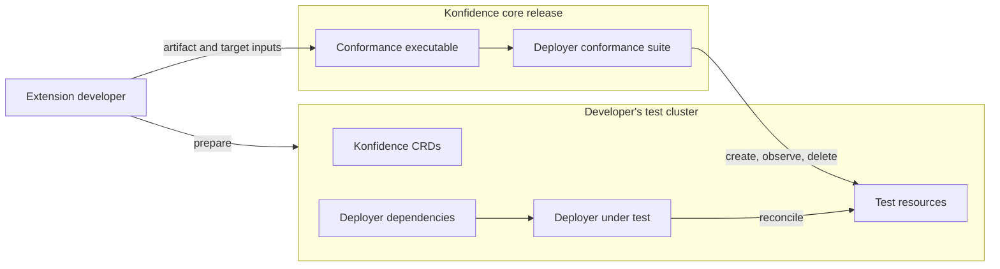
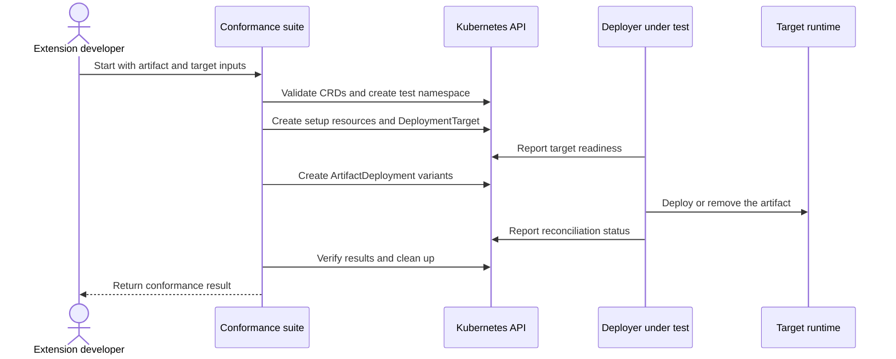

# ADR-0042: Execute conformance tests for a deployer implementation

<AdrHeader />

## Context

Deployers can be developed outside the Konfidence repositories. Their authors need a repeatable way to verify conformance without recreating the test cases or understanding unrelated Konfidence resources.

Konfidence cannot provide a universal test artifact or target configuration because these are specific to each deployer. However, requiring developers to create all test resources manually would introduce setup races and make destructive tests unsafe.

## Decision

The conformance suite owns the test-resource lifecycle. The extension developer provides only the deployer-specific inputs and prepares the environment in which the deployer runs.



### Developer responsibilities

The developer prepares a Kubernetes cluster containing:

- the Konfidence CRDs matching the conformance-suite version
- the deployer under test
- any dependencies and credentials required by the deployer

The complete Konfidence control plane and a Project, Landscape, Stage, or Vector hierarchy are not required.

The developer supplies these inputs to the suite:

| Input | Purpose |
| --- | --- |
| Kubeconfig | Selects the test cluster. |
| Application artifact | Describes a minimal valid application using OCM. The concrete transport may be a component descriptor YAML or a component-version reference in an OCM repository. |
| Deployment-target spec | Contains `artifactType` and optional deployer-specific `parameters`, without Kubernetes resource metadata. |
| Target setup manifests (optional) | Provide namespaced resources, such as Secrets, referenced by the target parameters. |

The application artifact should be small, deterministic, and require no manual interaction. Its artifact type must match the type in the deployment-target spec. It must contain the `konfidence-manifest`, task manifests, and deployer-specific resources needed to construct an `ArtifactDeployment`.

The suite exposes this as one logical `applicationArtifact` input. The ADR does not prescribe whether the executable accepts descriptor YAML, an OCM repository reference, or both. For example, a file-based implementation may expose `--artifact ./component-descriptor.yaml`, while a repository-backed implementation may expose `--artifact-reference <component-version>`.

The suite resolves the input into the component name, version, artifact manifest, task manifests, and deployer resources used by the generated `ArtifactDeployment`. It adds the Kubernetes metadata and namespace itself.

#### Artifact input options

| Option | Advantages | Disadvantages |
| --- | --- | --- |
| Component descriptor YAML | Works offline, avoids registry credentials in the suite, and is easy to version with the deployer tests. | A descriptor may not contain local resource payloads and can differ from the artifact that was actually published. Additional files or externally accessible resources may be required. |
| OCM component version from an OCI repository | Tests the real published artifact, including repository-managed local resources and access specifications. | Requires network access, OCM repository credentials, and secret handling. Registry availability can also make the test less deterministic. |

The choice is deliberately left to the implementation. Both options resolve to the same logical application-artifact model, so changing the transport does not change the conformance scenarios.

Example deployment-target spec:

```yaml
artifactType: app.example.com
parameters:
  apiGroup: ""
  kind: Secret
  name: conformance-target-credentials
```

The target input contains only the fields below `DeploymentTarget.spec`. The suite adds `apiVersion`, `kind`, metadata, and the generated namespace. Target setup manifests are created in the same namespace before the target.

### Running the suite

The suite is bundled as its own Cobra-based executable and published as a versioned asset with the Konfidence core release. Cobra provides the command-line interface; a command in the Kden CLI is not required.

```shell
konfidence-conformance \
  --kubeconfig ./conformance.kubeconfig \
  --artifact ./conformance/component-descriptor.yaml \
  --deployment-target-spec ./conformance/deployment-target-spec.yaml \
  --target-setup ./conformance/target-secret.yaml
```

The exact artifact flag depends on the selected artifact transport. `--target-setup` is optional and repeatable.

Before running the scenarios, the suite verifies that:

- the required CRDs are available
- the application artifact and target spec are valid
- the artifact resolves to one component and one `konfidence-manifest`
- the artifact and target use the same artifact type

Invalid inputs and missing prerequisites are reported as setup failures rather than skipped tests.

### Suite responsibilities

For each run, the suite:

1. creates an isolated test namespace
2. creates optional target setup resources
3. creates a `DeploymentTarget` from the supplied spec
4. creates an `ArtifactDeployment` and required test variants from the resolved application artifact
5. waits for and verifies the deployer's reconciliation results
6. removes the resources created by the run

The developer does not author or manually create `DeploymentTarget` or `ArtifactDeployment` resources. The suite uses bounded waits and returns a non-zero exit status when setup or conformance checks fail.



The valid generated artifact is the baseline for all scenarios. Generic variants, such as unsupported artifact types or missing resources, are derived from it. The suite does not guess how to mutate provider-specific payloads.

## Alternatives considered

### Require pre-created Konfidence resources

Rejected because it introduces readiness races and prevents the suite from safely controlling mutation and deletion scenarios.

### Require the complete Konfidence control plane

Rejected because orchestration outside the deployer contract would make conformance results depend on unrelated controllers.

### Let the suite install the deployer

Rejected because third-party deployers do not share an installation or dependency contract.

### Provide one universal artifact

Rejected because deployers can target fundamentally different runtimes and packaging formats.

## Consequences

- Extension developers provide a minimal OCM application artifact and a small deployment-target spec.
- Developers do not need to know the schemas or metadata conventions of the generated Konfidence resources.
- The conformance suite is independently executable and does not require Kden CLI integration.
- The suite controls ordering, readiness waits, isolation, and cleanup.
- Base conformance requires the Konfidence CRDs, but not the complete control plane.
- Provider-specific payload mutations may require additional fixtures or may be skipped when they cannot be derived safely.
