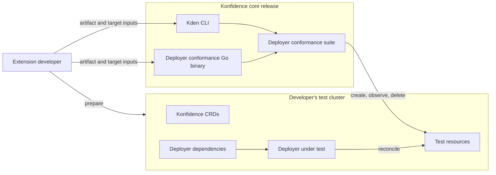
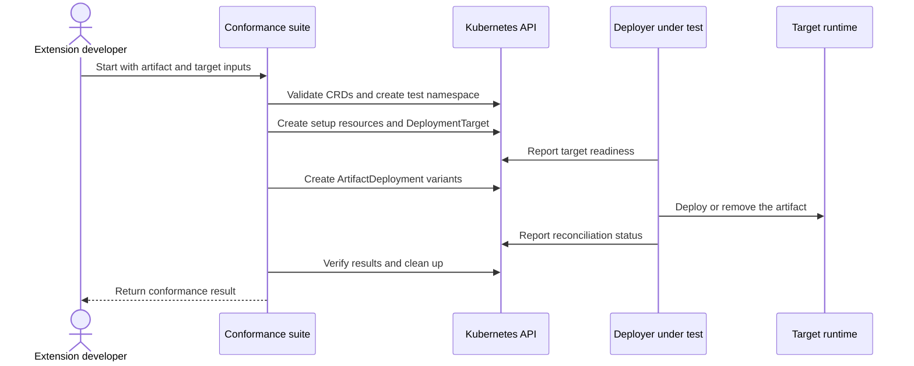

# ADR-0042: Execute conformance tests for a deployer implementation

<AdrHeader />

## Context

Deployers can be developed outside the Konfidence repositories. Their authors need a repeatable way to verify conformance without recreating the test cases or understanding unrelated Konfidence resources.

Konfidence cannot provide a universal test artifact or target configuration because these are specific to each deployer. However, requiring developers to create all test resources manually would introduce setup races and make destructive tests unsafe.

## Decision

The conformance suite owns the test-resource lifecycle. The extension developer provides only the deployer-specific inputs and prepares the environment in which the deployer runs.



### Developer responsibilities

The developer prepares a Kubernetes cluster containing:

- the Konfidence CRDs matching the conformance-suite version
- the deployer under test
- any dependencies and credentials required by the deployer

The complete Konfidence control plane and a Project, Landscape, Stage, or Vector hierarchy are not required.

The developer supplies these inputs to the suite:

| Input | Purpose |
| --- | --- |
| Kubeconfig | Selects the test cluster. |
| OCM component constructor | Describes a minimal valid artifact for the deployer. This is the same artifact definition used with `kden artifact push`. |
| Deployment-target spec | Contains `artifactType` and optional deployer-specific `parameters`, without Kubernetes resource metadata. |
| Target setup manifests (optional) | Provide namespaced resources, such as Secrets, referenced by the target parameters. |

The artifact should be small, deterministic, and require no manual interaction. Its artifact type must match the type in the deployment-target spec.

The suite does not access the developer's OCM repository. The component constructor must therefore use self-contained external access specifications for deployer-consumed resources. Local Konfidence manifest and task-manifest files may be read from the constructor directory.

The suite maps the component name, version, artifact manifest, task manifests, and external resource access specifications into the generated `ArtifactDeployment`. It adds the Kubernetes metadata and namespace itself.

Example deployment-target spec:

```yaml
artifactType: app.example.com
parameters:
  apiGroup: ""
  kind: Secret
  name: conformance-target-credentials
```

The target input contains only the fields below `DeploymentTarget.spec`. The suite adds `apiVersion`, `kind`, metadata, and the generated namespace. Target setup manifests are created in the same namespace before the target.

### Running the suite

The conformance suite can be executed through the `kden` CLI:

```shell
kden conformance deployer run \
  --kubeconfig ./conformance.kubeconfig \
  --artifact-constructor ./conformance/component-constructor.yaml \
  --deployment-target-spec ./conformance/deployment-target-spec.yaml \
  --target-setup ./conformance/target-secret.yaml
```

The `conformance` command provides a common entry point for deployer conformance and can later expose suites for other Konfidence extension points.

The deployer conformance Go binary is also published as a versioned asset with the Konfidence core release. It can be downloaded and executed directly with the same inputs, which is useful for CI environments that do not install the CLI.

```shell
konfidence-conformance \
  --kubeconfig ./conformance.kubeconfig \
  --artifact-constructor ./conformance/component-constructor.yaml \
  --deployment-target-spec ./conformance/deployment-target-spec.yaml \
  --target-setup ./conformance/target-secret.yaml
```

`--target-setup` is optional and repeatable for both entry points. Both entry points execute the same suite and produce the same result.

Before running the scenarios, the suite verifies that:

- the required CRDs are available
- the component constructor and target spec are valid
- the constructor contains one component and one `konfidence-manifest`
- the artifact and target use the same artifact type

Invalid inputs and missing prerequisites are reported as setup failures rather than skipped tests.

### Suite responsibilities

For each run, the suite:

1. creates an isolated test namespace
2. creates optional target setup resources
3. creates a `DeploymentTarget` from the supplied spec
4. creates an `ArtifactDeployment` and required test variants from the OCM artifact definition
5. waits for and verifies the deployer's reconciliation results
6. removes the resources created by the run

The developer does not author or manually create `DeploymentTarget` or `ArtifactDeployment` resources. The suite uses bounded waits and returns a non-zero exit status when setup or conformance checks fail.



The valid generated artifact is the baseline for all scenarios. Generic variants, such as unsupported artifact types or missing resources, are derived from it. The suite does not guess how to mutate provider-specific payloads.

## Alternatives considered

### Require pre-created Konfidence resources

Rejected because it introduces readiness races and prevents the suite from safely controlling mutation and deletion scenarios.

### Require the complete Konfidence control plane

Rejected because orchestration outside the deployer contract would make conformance results depend on unrelated controllers.

### Let the suite install the deployer

Rejected because third-party deployers do not share an installation or dependency contract.

### Provide one universal artifact

Rejected because deployers can target fundamentally different runtimes and packaging formats.

## Consequences

- Extension developers maintain their normal OCM artifact definition and a small deployment-target spec.
- Developers do not need to know the schemas or metadata conventions of the generated Konfidence resources.
- The Kden CLI provides a common entry point for conformance suites.
- The `kden conformance` command can accommodate suites for additional extension points in the future.
- The suite controls ordering, readiness waits, isolation, and cleanup.
- Base conformance requires the Konfidence CRDs, but not the complete control plane.
- Provider-specific payload mutations may require additional fixtures or may be skipped when they cannot be derived safely.
